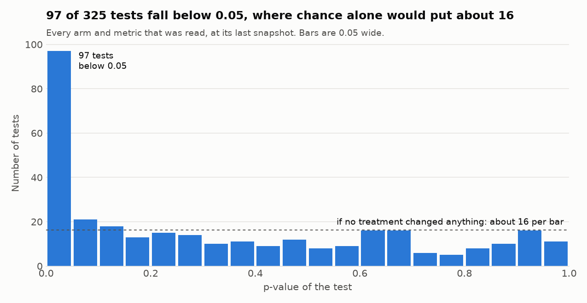
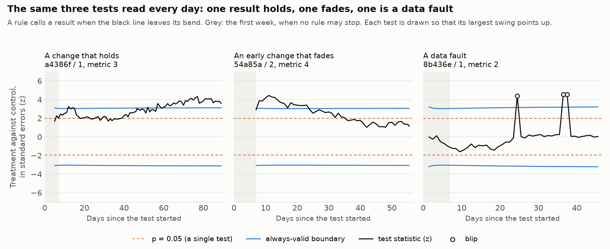

# A/B test readout: from raw experiment data to a go / no-go decision

[](https://github.com/nisha1324/ab-test-readout/actions/workflows/ci.yml)

**Status: all four parts done** (data checks, the readout, the cost of peeking and the decision memo). A short summary of the whole project is the last step; see the [roadmap](#roadmap).

A product team runs an A/B test and asks one question: *do we launch?* A good answer needs more than a p-value. It needs to know whether the test can be trusted, whether it was big enough to see the change that matters, whether anything else got worse, and what happens if people look at the results every day and stop when they like what they see.

This project works through those steps on 78 real experiments from an online fashion retailer, and ends with a written [go / no-go memo](results/DECISION_MEMO.md). It is statistics and SQL, not machine learning.

## The data

The **ASOS Digital Experiments Dataset** (Liu, Cardoso, Couturier and McCoy, *Datasets for Online Controlled Experiments*, NeurIPS 2021 Datasets and Benchmarks): results of 78 online experiments run by one business unit of ASOS.com in 2019 and 2020.

- Source: <https://osf.io/64jsb/> (DOI 10.17605/OSF.IO/64JSB). Licence: **CC BY 4.0**. No key or sign-up.
- 24,153 rows, 2.7 MB, committed in `data/raw/` with its SHA-256 pinned. `scripts/download_data.py` checks the copy against the source.
- One row is one experiment × treatment arm × metric × snapshot time: the number of users, the mean and the variance for the control group and the treatment group, cumulative since the test started, recorded mostly every 12 or 24 hours. There are no user-level rows.
- Four metrics per experiment. The source does not name them: metric 1 is a yes/no per user, metrics 2 and 3 are counts, metric 4 is a non-negative amount.

Two limits come with the data and shape everything here. The experiments are anonymous (no names, dates, intended traffic split or metric names), and the source's datasheet says they are not representative of ASOS's business. So this project shows **how to read experiments like these**. It draws no conclusion about ASOS.

## Part 1: can these experiments be read at all?

Full report: [`results/DATA_CHECKS.md`](results/DATA_CHECKS.md). Per-arm results: [`results/arm_checks.csv`](results/arm_checks.csv).

Before looking at any metric, each of the 99 treatment arms is asked three questions: did each group get its share of users, did the split hold while the test ran, and was the test measured for long enough.

**62 of the 99 arms (50 of 78 experiments) pass every check. 37 carry at least one caution.**

### Did each group get its share of users?

If a test is meant to split users 50/50 and one group ends up short, some users went missing after they were assigned. That is a *sample-ratio mismatch*, and it makes the comparison unfair before any metric is read.


- Testing every arm against 50/50 raises **12 alarms** (p < 0.001). Only **4** look like users going missing: the treatment group is within half a point of 50% and short by 7,454 to 41,070 users.
- Those imbalances are small. The largest shortfall is 41,070 users out of 62.9 million (a treatment share of 49.935%). The test is big enough that chance cannot explain even that.
- The other **8** arms are too far from 50% for that story (treatment shares from 2.99% to 88.67%). Either the split was unequal by design or the test is broken; the data alone cannot say. 5 of the 8 are consistent with a named design: a three-way 34/33/33 split or a 1:2 split. That is an inference, since the source does not publish the intended split.
- A check that needs no intended split, whether the treatment share of *new* users stays the same from week to week, finds **4** arms where it drifts.

### Was each test measured for long enough?


- **6 arms in 3 experiments end before day 7.** A test that has not seen every day of the week is too short to decide on, however many users it has.
- **14 arms** have their first snapshot after day 7, and **6** have 3 or more days with no snapshot. Their final result is readable, but what a daily look would have shown is not, which matters for Part 3.

### What the metrics are


- The metrics are cumulative, so they keep growing while a test runs: at half-time the median control mean is 87% of its final value for metric 1 and 72% for metric 4.
- Metrics 2 to 4 are noisier than metric 1 (median standard deviation ÷ mean of 2.75, 3.23 and 3.43, against 2.02), so the same relative change needs more users to detect. Part 2 turns that into a sample size.
- 5 arms have no variance for metrics 2 to 4 at their last snapshot, which matches the source's datasheet. Those metrics cannot be tested for those arms.

### So what does this mean for the business?

1. **Check the split before the metrics, and against the intended split.** A team that tests everything against 50/50 would have stopped 12 arms here; 8 of them are too far from 50% to be an even test that lost a few users. The intended allocation belongs in the experiment record, next to the results.
2. **Report the size of a sample-ratio alarm, not just the alarm.** In a test with tens of millions of users, a real alarm can be less than a tenth of a point away from 50%. The decision is about what the missing users could have changed.
3. **Do not decide on a test shorter than a week, and keep the daily record complete.** 26 of 99 arms here ended within a week, were first recorded late or have a hole in the record.
4. **Never compare a metric across different days of a test.** A treatment mean from day 28 against a control mean from day 14 would show a "win" that is only the calendar.

## Part 2: what did the tests find, and were they big enough?

Full report: [`results/READOUT.md`](results/READOUT.md). Every arm and metric: [`results/readout.csv`](results/readout.csv).

Each arm is read at its last snapshot. For each of its four metrics: the relative change (treatment mean ÷ control mean − 1) with a 95% confidence interval, a Welch t-test, and the smallest change the test could reliably have detected. Part 1's cautions carry through: the 14 arms with an unexplained split or under a week of data are not decided on, 6 arms are read with a warning, and metrics with no variance are not tested. That leaves **325 tests in 85 arms**.

One limit applies to everything below: the metrics are not named, so a higher value could be good or bad. This part says "higher" and "lower", never "won" and "lost".

### How many tests show a change?


- **97 of 325 tests (30%) are significant at p < 0.05.** If no treatment changed anything, about 16 would be.
- **The changes are small.** The median significant change is 0.76% of the control mean and the largest is 3.78%; 58 of the 97 are under 1%.
- Treatment is higher in 50 of the significant tests and lower in 47. No arm has one metric significantly higher and another significantly lower.

### Was each test big enough to see a change worth having?


- Taking a 1% relative change as "worth having" (a working choice), **273 of the 325 tests could detect it** 80% of the time. The most sensitive could detect 0.19%, the least sensitive only 6.7%.
- Noisier metrics need more users. An even two-group test needs about 639,000 users per group to detect a 1% change in metric 1 and about 1,847,000 for metric 4. Halving the change to detect quadruples the users.
- **"Not significant" has two meanings.** Of the 228 quiet tests, 189 have a confidence interval entirely between −1% and +1%: they rule out a change of 1% or more, which is a finding. The other 39 are too wide to say anything.

### What does reading four metrics at once do?



- Four metrics are four chances of a false alarm: up to 18.5% per arm, not 5%, if the metrics were independent (here they move together, so the true figure is lower).
- **41 of 85 arms (48%) have at least one significant metric.** After Holm's correction over all the tests of one experiment, **29 arms** do, and 72 of the 97 significant tests survive. The other 25 are unconfirmed.
- 11 arms are significant on every metric they report. Those are the clear results.
- None of the 4 significant tests in arms read with a warning survives the correction.

### So what does this mean for the business?

1. **Expect small changes and size tests for them.** The median significant change here is 0.76%. Detecting a 1% change takes roughly 0.6 to 1.8 million users per group, depending on the metric; a team with less traffic should test bigger changes or run longer, and know which before starting.
2. **Name the deciding metric before the test.** "Any of four metrics moved" would call 41 of 85 arms a result; after correction 29 are. One primary metric chosen in advance needs no correction, and the rest become guard rails (Part 4).
3. **Report the interval, not just "significant" or "not".** 189 of 228 quiet results are tight enough to say the change is under 1% either way, which can close a decision. The other 39 say only that the test was too small.
4. **Record what each metric is and which direction is good.** Without that, this dataset leaves 50 changes up and 47 down, and no way to call any of them a win.

## Part 3: what happens if someone looks every day?

Full report: [`results/PEEKING.md`](results/PEEKING.md). Every test under every rule: [`results/peeking.csv`](results/peeking.csv).

Part 2 read each test once, at the end. Real teams look at the dashboard every day. This part replays 67 of the 85 arms (265 tests) as a series of daily looks; the other 18 arms have an incomplete daily record (Part 1). It also simulates tests in which nothing changed, on each arm's own schedule of looks. No rule may stop a test before day 7.

### Looking every day multiplies false alarms


- A single test at the 5% level gives a false alarm in 5% of tests where nothing changed. **Calling a result at the first daily look with p < 0.05 gives one in 17.6%** on these arms' schedules (4.9% to 28.6% depending on the arm).
- With equally spaced looks the simulated rate is 19.3% for 10 looks and 37.4% for 100.
- An *always-valid* rule is built to be checked at every look (the mixture sequential probability ratio test: it calls a result when the evidence for "some change" is 20 times the evidence for "no change"). Its simulated false-alarm rate here is 1.1%, and 0.7% when the signal has to be there on two looks in a row.

### What the real tests show


- **78 of the 265 tests are significant at the end. Daily peeking would have called 148**, and 70 of those are not significant when the test ends. If no treatment had changed anything, peeking would be expected to call about 47.
- By arm, 51 of 67 arms show a "significant" metric on some day, against 35 at the end.
- **A result called early is overstated.** For the 78 tests that end significant, the change on the day peeking called it was larger than the final one in 63, by a median factor of 1.31.
- **The always-valid rule, confirmed on the next look, calls 59 results:** 48 of the 78 that end significant and 11 that do not. For those 48 it decides on a median of day 7.5 of a test that ran 34.5 days, 24 days sooner.
- It misses 30 tests that end significant. That is the price of its higher bar: 3.04 standard errors or more at every look in these tests, against 1.96 for a single test.

### Snapshots that cannot be right



- Replaying the looks turned up a data fault that Part 1's checks on user counts could not see: **50 blips**, where a result jumps by more than 3 standard errors and jumps back within three looks. 46 of the 50 are in metric 2. Chance almost never does this: the simulation has 3 such looks in 59.7 million, the real tests 64 in 11,687.
- A rule that acts on the first signal acts on these: 16 of the 83 always-valid results were called inside a blip. Asking for two looks in a row removes the one-look blips; 4 of the 59 confirmed results were still called inside a longer one.
- One Part 2 result (`adea31` / 2, metric 4) rests on a last snapshot that is more than 3 standard errors away from the look before it. No later look can confirm or clear it, so that figure deserves a second look.
- **7 results passed the confirmed rule with no fault marked and are not significant at the end**, where chance would give about 2 in all 265 tests. Either the change was real and wore off, or the simulation understates the false-alarm rate for cumulative metrics; this data cannot say which.

### So what does this mean for the business?

1. **Do not stop a test on the first p < 0.05.** Here it would have called 148 results where 78 held to the end. Either fix the end date before the test and read it once, or use a rule built for daily looks.
2. **If the team wants to look every day, give it an always-valid rule.** It found 48 of the 78 results that held, a median of 24 days early, with a simulated false-alarm rate of 0.7%. Those days are test capacity for the next idea.
3. **Never act on a single look, and check the snapshot before the statistics.** Two looks in a row cost a day and remove the one-look faults. The pipeline should hold back any snapshot whose result jumps away from the day before.
4. **Set a minimum run for the business, not only for the statistics.** With no decision before day 28 the confirmed rule calls 49 results and 5 do not last, against 59 and 11 from day 7. A decision about a permanent change needs a test long enough to see whether the change lasts.
5. **Re-read the size at the end.** A result called early is overstated (a median factor of 1.35 for the confirmed rule), so a forecast built on the day-of-decision figure will disappoint.

## Part 4: so, do we launch?

The memo: [`results/DECISION_MEMO.md`](results/DECISION_MEMO.md). Every arm and its verdict: [`results/decisions.csv`](results/decisions.csv).

Parts 1 to 3 each give a reason to doubt a result. This part turns them into one rule per treatment and writes the answer down. One metric is the *primary*, the one the test was run to move (here metric 1, a working choice); the other three are *guard rails*, which a launch must not make worse. A treatment is a **launch** only if Part 1 found nothing wrong with the test, its last snapshot does not jump (Part 3), the primary is significantly better after allowing for the number of treatments in the experiment, and every guard rail's interval rules out a loss of 1% or more. The source does not say which direction is good, so every verdict is worked out both ways.


- **13 of the 99 treatments pass every rule for a launch** if higher is better (10 if lower is better). 20 are "do not launch", 37 "no change", 8 "run longer", 7 "check the data" and 14 "no decision".
- **"Significant" is where the decision starts.** 16 arms end with the primary significantly higher and 13 are launches. "Launch if any of the four metrics is significantly higher" would pick 20.
- **The guard rails never stopped a launch, and still earned their place.** 10 arms have a primary that is not significantly different and a guard rail that is significantly worse. In 8 of them the primary alone reads "no change".
- **8 of the 11 launches that have a complete daily record also pass Part 3's always-valid rule.** The other 3 are launches only if their end date was fixed in advance, which the source does not say.
- **The direction decides the answer.** 61 of the 99 verdicts are the same either way; all 13 launches become "do not launch" if lower is better.
- **So does the choice of primary.** Of the 78 arms that get a verdict on the metrics, 57 get the same one whichever metric is the primary. 17 arms are a launch under at least one choice and 7 under every choice.
- Part 3's check for a suspect last snapshot, run here on all 325 tests, finds 1: the one already known.

### Seven decisions, written out


The memo writes up seven treatments, picked by rule so that each shows a different kind of answer:

| Treatment | What the memo says (if higher is better) |
| --- | --- |
| `2c8a04` / 1 | **Launch.** Primary up 1.94%, guard rails up too, clean test |
| `b8a409` / 1 | **Launch only if the end date was planned.** Primary up 0.39% with p = 0.043, never confirmed under daily looks |
| `adea31` / 1 | **Do not launch.** Primary flat, two guard rails significantly lower |
| `adea31` / 2 | **Check the data.** A strong result that rests on a last snapshot that jumped |
| `3683df` / 1 | **No change.** 93 million users rule out a change of 1% either way |
| `591c2c` / 1 | **Cannot tell.** Could only detect a 4.4% change; a 1% change would need about 238 days |
| `26bd38` / 1 | **Check the data.** Primary up 0.38%, but the treatment group is 0.39% short of users |

### So what does this mean for the business?

1. **Write the decision rule before the test:** primary metric, direction, guard rails, margin and end date. Each is missing from this dataset and each changes verdicts: the direction changes 38 of 99, the choice of primary 21 of 78.
2. **Read every guard rail on every test, most of all the quiet ones.** Half of the 20 "do not launch" verdicts here come from a guard rail in a test whose primary did not move.
3. **Separate "no change" from "cannot tell".** 37 tests rule out a change of 1%, which closes the idea. 8 cannot tell, and for the smallest no realistic run would. Check what a test can detect before starting it.
4. **Record how the test ended.** A launch read once on a planned end date and a launch that survived daily looks are different claims; 3 of the launches here depend on which it was.

## Roadmap

1. ~~Data checks: structure, sample-ratio mismatch, split stability, coverage, metric definitions~~ (done)
2. ~~The readout: effect and confidence interval per arm and metric, whether each test was big enough to see a change worth having (sample size and minimum detectable effect), and what testing four metrics at once does to the false-alarm rate~~ (done)
3. ~~The cost of peeking: what happens to the error rate when results are checked every day, and a stopping rule that allows for it~~ (done)
4. ~~Decision rules with guard-rail metrics and a written go / no-go memo for a handful of experiments~~ (done)
5. A one-page summary of the whole project at the top of this README

## How to run it

```bash
python -m venv .venv && source .venv/bin/activate
pip install -r requirements-lock.txt      # the exact versions the committed outputs were made with

python scripts/download_data.py           # optional: verify data/raw against the pinned SHA-256
python scripts/data_checks_report.py      # Part 1: results/DATA_CHECKS.md, 3 CSVs, 3 charts
python scripts/readout_report.py          # Part 2: results/READOUT.md, 2 CSVs, 3 charts
python scripts/peeking_report.py          # Part 3: results/PEEKING.md, 4 CSVs, 3 charts (seeded simulation, about a minute)
python scripts/decision_report.py         # Part 4: results/DECISION_MEMO.md, 3 CSVs, 2 charts
pytest -q
```

Python 3.12. `requirements.txt` has the loose version ranges; `requirements-lock.txt` pins what was used. GitHub Actions reruns all four reports on every push and fails if any committed output changes.

## What is where

| Path | What it is |
| --- | --- |
| `data/raw/` | The source CSV, unchanged |
| `sql/` | DuckDB SQL: structural rules (`integrity.sql`), one row per arm (`arm_summary.sql`), one row per metric (`metric_profile.sql`), the last snapshot of every arm and metric (`final_snapshot.sql`), one look per day (`daily_looks.sql`) |
| `abtest/checks.py` | Sample-ratio test, split-stability test and the caution rules, with every threshold in one place |
| `abtest/readout.py` | Welch test, delta-method interval for the relative change, smallest detectable change, sample size, Holm and Benjamini-Hochberg corrections |
| `abtest/peeking.py` | The daily replay, the always-valid rule (mixture sequential probability ratio test), the blip check and the seeded simulation of tests where nothing changed |
| `abtest/decision.py` | The decision rules: primary and guard-rail readings, the order they are applied in, the correction across treatment arms and the last-snapshot check on every test |
| `abtest/load.py`, `abtest/source.py` | Loading, the source URL and the pinned hash |
| `scripts/` | `download_data.py` and the four report generators |
| `results/` | The generated reports, CSVs and charts |
| `tests/` | Hand-worked cases for every check and formula, the real data against independent pandas and scipy calculations, simulations checked against exact and published results, and every figure in this README against the generated results |

## Limits

- No intended split, dates or metric names are published. Statements about design are inferences and are labelled as such.
- The thresholds (p < 0.001, half a point around 50%, 7 days, a 3-day gap) are working choices made after looking at the data; they are set in `abtest/checks.py`.
- The checks use user counts only. They show that a split is off, not why, and not which users are missing.
- The chi-square tests treat users as independent. Real traffic is lumpier, so the p-values are somewhat too small, most of all for the largest tests.
- Passing these checks does not prove an experiment is sound. Problems that leave user counts untouched are invisible here.
- Part 2 reads each arm once, at its last snapshot, at the 5% level with 80% power and a 1% reference change (set in `abtest/readout.py`). If tests were stopped because of what the results showed, its p-values are too small; Part 3 measures that.
- Part 3 uses the end-of-test reading as its yardstick, and that reading can be wrong too. Its simulation treats each user's value as fixed once counted; these metrics are cumulative, so the simulated false-alarm rates are best read as lower ends for every rule.
- The blip rule (more than 3 standard errors there and back, within 3 looks) is a working choice made after looking at the data. It cannot judge the first or last look of a test and was only run on the 265 tests replayed.
- Part 4's primary (metric 1), the 1% margin and the direction are working choices; the source publishes none of them. One direction is applied to all four metrics. Its verdicts are examples of how to decide and say nothing about what ASOS did or should have done.
- Part 4 checks guard rails at an uncorrected p < 0.05, three per arm, so some "guard rail worse" verdicts are false alarms. That is the price of a low bar for bad news.
- The metrics are not named, so no change can be called good or bad, and none can be given a money value.

## Credit

Data: C. H. Bryan Liu, Ângelo Cardoso, Paul Couturier and Emma J. McCoy, *ASOS Digital Experiments Dataset*, <https://osf.io/64jsb/>, CC BY 4.0. The analysis, code and any errors are mine.
