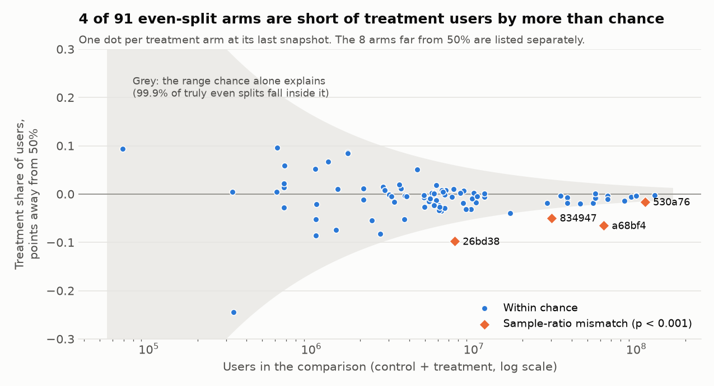
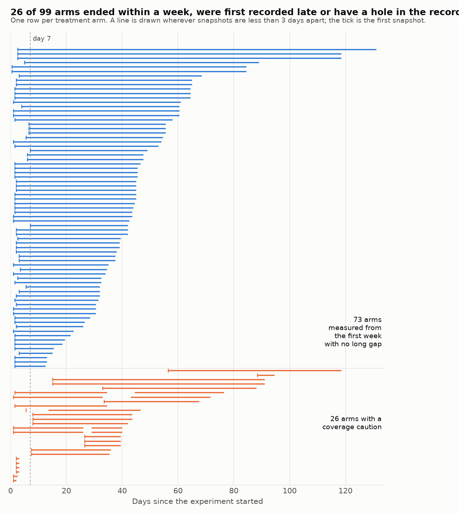
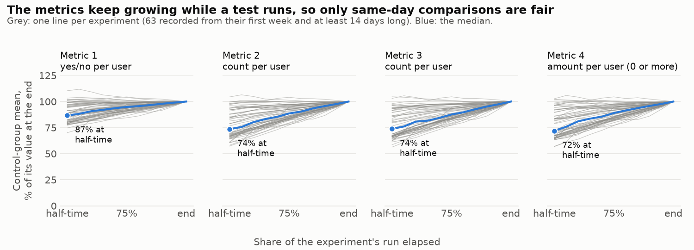
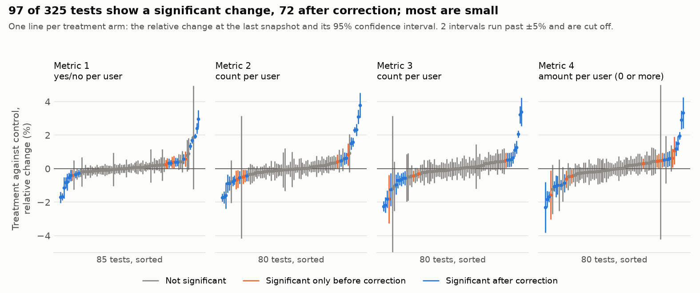
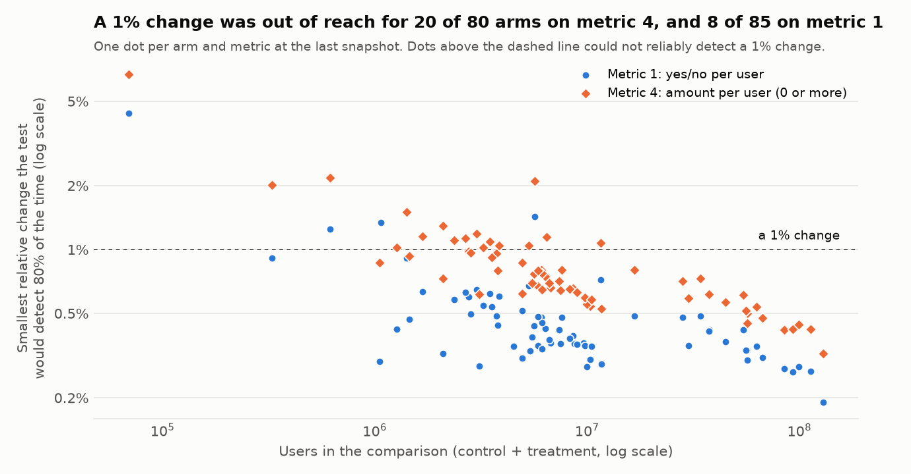

# A/B test readout: from raw experiment data to a go / no-go decision

[](https://github.com/nisha1324/ab-test-readout/actions/workflows/ci.yml)

**Status: Part 2 of 4 done** (data checks and the readout). The cost of peeking and the decision memo are next; see the [roadmap](#roadmap).

A product team runs an A/B test and asks one question: *do we launch?* A good answer needs more than a p-value. It needs to know whether the test can be trusted, whether it was big enough to see the change that matters, whether anything else got worse, and what happens if people look at the results every day and stop when they like what they see.

This project works through those steps on 78 real experiments from an online fashion retailer, and ends with a written go / no-go memo. It is statistics and SQL, not machine learning.

## The data

The **ASOS Digital Experiments Dataset** (Liu, Cardoso, Couturier and McCoy, *Datasets for Online Controlled Experiments*, NeurIPS 2021 Datasets and Benchmarks): results of 78 online experiments run by one business unit of ASOS.com in 2019 and 2020.

- Source: <https://osf.io/64jsb/> (DOI 10.17605/OSF.IO/64JSB). Licence: **CC BY 4.0**. No key or sign-up.
- 24,153 rows, 2.7 MB, committed in `data/raw/` with its SHA-256 pinned. `scripts/download_data.py` checks the copy against the source.
- One row is one experiment × treatment arm × metric × snapshot time: the number of users, the mean and the variance for the control group and the treatment group, cumulative since the test started, recorded mostly every 12 or 24 hours. There are no user-level rows.
- Four metrics per experiment. The source does not name them: metric 1 is a yes/no per user, metrics 2 and 3 are counts, metric 4 is a non-negative amount.

Two limits come with the data and shape everything here. The experiments are anonymous (no names, dates, intended traffic split or metric names), and the source's datasheet says they are not representative of ASOS's business. So this project shows **how to read experiments like these**. It draws no conclusion about ASOS.

## Part 1: can these experiments be read at all?

Full report: [`results/DATA_CHECKS.md`](results/DATA_CHECKS.md). Per-arm results: [`results/arm_checks.csv`](results/arm_checks.csv).

Before looking at any metric, each of the 99 treatment arms is asked three questions: did each group get its share of users, did the split hold while the test ran, and was the test measured for long enough.

**62 of the 99 arms (50 of 78 experiments) pass every check. 37 carry at least one caution.**

### Did each group get its share of users?

If a test is meant to split users 50/50 and one group ends up short, some users went missing after they were assigned. That is a *sample-ratio mismatch*, and it makes the comparison unfair before any metric is read.



- Testing every arm against 50/50 raises **12 alarms** (p < 0.001). Only **4** look like users going missing: the treatment group is within half a point of 50% and short by 7,454 to 41,070 users.
- Those imbalances are small. The largest shortfall is 41,070 users out of 62.9 million (a treatment share of 49.935%). The test is big enough that chance cannot explain even that.
- The other **8** arms are too far from 50% for that story (treatment shares from 2.99% to 88.67%). Either the split was unequal by design or the test is broken; the data alone cannot say. 5 of the 8 are consistent with a named design: a three-way 34/33/33 split or a 1:2 split. That is an inference, since the source does not publish the intended split.
- A check that needs no intended split, whether the treatment share of *new* users stays the same from week to week, finds **4** arms where it drifts.

### Was each test measured for long enough?



- **6 arms in 3 experiments end before day 7.** A test that has not seen every day of the week is too short to decide on, however many users it has.
- **14 arms** have their first snapshot after day 7, and **6** have 3 or more days with no snapshot. Their final result is readable, but what a daily look would have shown is not, which matters for Part 3.

### What the metrics are



- The metrics are cumulative, so they keep growing while a test runs: at half-time the median control mean is 87% of its final value for metric 1 and 72% for metric 4.
- Metrics 2 to 4 are noisier than metric 1 (median standard deviation ÷ mean of 2.75, 3.23 and 3.43, against 2.02), so the same relative change needs more users to detect. Part 2 turns that into a sample size.
- 5 arms have no variance for metrics 2 to 4 at their last snapshot, which matches the source's datasheet. Those metrics cannot be tested for those arms.

### So what does this mean for the business?

1. **Check the split before the metrics, and against the intended split.** A team that tests everything against 50/50 would have stopped 12 arms here; 8 of them are too far from 50% to be an even test that lost a few users. The intended allocation belongs in the experiment record, next to the results.
2. **Report the size of a sample-ratio alarm, not just the alarm.** In a test with tens of millions of users, a real alarm can be less than a tenth of a point away from 50%. The decision is about what the missing users could have changed.
3. **Do not decide on a test shorter than a week, and keep the daily record complete.** 26 of 99 arms here ended within a week, were first recorded late or have a hole in the record.
4. **Never compare a metric across different days of a test.** A treatment mean from day 28 against a control mean from day 14 would show a "win" that is only the calendar.

## Part 2: what did the tests find, and were they big enough?

Full report: [`results/READOUT.md`](results/READOUT.md). Every arm and metric: [`results/readout.csv`](results/readout.csv).

Each arm is read at its last snapshot. For each of its four metrics: the relative change (treatment mean ÷ control mean − 1) with a 95% confidence interval, a Welch t-test, and the smallest change the test could reliably have detected. Part 1's cautions carry through: the 14 arms with an unexplained split or under a week of data are not decided on, 6 arms are read with a warning, and metrics with no variance are not tested. That leaves **325 tests in 85 arms**.

One limit applies to everything below: the metrics are not named, so a higher value could be good or bad. This part says "higher" and "lower", never "won" and "lost".

### How many tests show a change?



- **97 of 325 tests (30%) are significant at p < 0.05.** If no treatment changed anything, about 16 would be.
- **The changes are small.** The median significant change is 0.76% of the control mean and the largest is 3.78%; 58 of the 97 are under 1%.
- Treatment is higher in 50 of the significant tests and lower in 47. No arm has one metric significantly higher and another significantly lower.

### Was each test big enough to see a change worth having?



- Taking a 1% relative change as "worth having" (a working choice), **273 of the 325 tests could detect it** 80% of the time. The most sensitive could detect 0.19%, the least sensitive only 6.7%.
- Noisier metrics need more users. An even two-group test needs about 639,000 users per group to detect a 1% change in metric 1 and about 1,847,000 for metric 4. Halving the change to detect quadruples the users.
- **"Not significant" has two meanings.** Of the 228 quiet tests, 189 have a confidence interval entirely between −1% and +1%: they rule out a change of 1% or more, which is a finding. The other 39 are too wide to say anything.

### What does reading four metrics at once do?


- Four metrics are four chances of a false alarm: up to 18.5% per arm, not 5%, if the metrics were independent (here they move together, so the true figure is lower).
- **41 of 85 arms (48%) have at least one significant metric.** After Holm's correction over all the tests of one experiment, **29 arms** do, and 72 of the 97 significant tests survive. The other 25 are unconfirmed.
- 11 arms are significant on every metric they report. Those are the clear results.
- None of the 4 significant tests in arms read with a warning survives the correction.

### So what does this mean for the business?

1. **Expect small changes and size tests for them.** The median significant change here is 0.76%. Detecting a 1% change takes roughly 0.6 to 1.8 million users per group, depending on the metric; a team with less traffic should test bigger changes or run longer, and know which before starting.
2. **Name the deciding metric before the test.** "Any of four metrics moved" would call 41 of 85 arms a result; after correction 29 are. One primary metric chosen in advance needs no correction, and the rest become guard rails (Part 4).
3. **Report the interval, not just "significant" or "not".** 189 of 228 quiet results are tight enough to say the change is under 1% either way, which can close a decision. The other 39 say only that the test was too small.
4. **Record what each metric is and which direction is good.** Without that, this dataset leaves 50 changes up and 47 down, and no way to call any of them a win.

## Roadmap

1. ~~Data checks: structure, sample-ratio mismatch, split stability, coverage, metric definitions~~ (done)
2. ~~The readout: effect and confidence interval per arm and metric, whether each test was big enough to see a change worth having (sample size and minimum detectable effect), and what testing four metrics at once does to the false-alarm rate~~ (done)
3. The cost of peeking: what happens to the error rate when results are checked every day, and a stopping rule that allows for it
4. Decision rules with guard-rail metrics, a written go / no-go memo for a handful of experiments, and the final summary

## How to run it

```bash
python -m venv .venv && source .venv/bin/activate
pip install -r requirements-lock.txt      # the exact versions the committed outputs were made with

python scripts/download_data.py           # optional: verify data/raw against the pinned SHA-256
python scripts/data_checks_report.py      # Part 1: results/DATA_CHECKS.md, 3 CSVs, 3 charts
python scripts/readout_report.py          # Part 2: results/READOUT.md, 2 CSVs, 3 charts
pytest -q
```

Python 3.12. `requirements.txt` has the loose version ranges; `requirements-lock.txt` pins what was used. GitHub Actions reruns both reports on every push and fails if any committed output changes.

## What is where

| Path | What it is |
| --- | --- |
| `data/raw/` | The source CSV, unchanged |
| `sql/` | DuckDB SQL: structural rules (`integrity.sql`), one row per arm (`arm_summary.sql`), one row per metric (`metric_profile.sql`), the last snapshot of every arm and metric (`final_snapshot.sql`) |
| `abtest/checks.py` | Sample-ratio test, split-stability test and the caution rules, with every threshold in one place |
| `abtest/readout.py` | Welch test, delta-method interval for the relative change, smallest detectable change, sample size, Holm and Benjamini-Hochberg corrections |
| `abtest/load.py`, `abtest/source.py` | Loading, the source URL and the pinned hash |
| `scripts/` | `download_data.py` and the two report generators |
| `results/` | The generated report, CSVs and charts |
| `tests/` | Hand-worked cases for every check and formula, the real data against independent pandas and scipy calculations, a simulation of the interval's coverage, and every figure in this README against the generated results |

## Limits

- No intended split, dates or metric names are published. Statements about design are inferences and are labelled as such.
- The thresholds (p < 0.001, half a point around 50%, 7 days, a 3-day gap) are working choices made after looking at the data; they are set in `abtest/checks.py`.
- The checks use user counts only. They show that a split is off, not why, and not which users are missing.
- The chi-square tests treat users as independent. Real traffic is lumpier, so the p-values are somewhat too small, most of all for the largest tests.
- Passing these checks does not prove an experiment is sound. Problems that leave user counts untouched are invisible here.
- Part 2 reads each arm once, at its last snapshot, at the 5% level with 80% power and a 1% reference change (set in `abtest/readout.py`). If tests were stopped because of what the results showed, its p-values are too small; Part 3 measures that.
- The metrics are not named, so no change can be called good or bad, and none can be given a money value.

## Credit

Data: C. H. Bryan Liu, Ângelo Cardoso, Paul Couturier and Emma J. McCoy, *ASOS Digital Experiments Dataset*, <https://osf.io/64jsb/>, CC BY 4.0. The analysis, code and any errors are mine.
