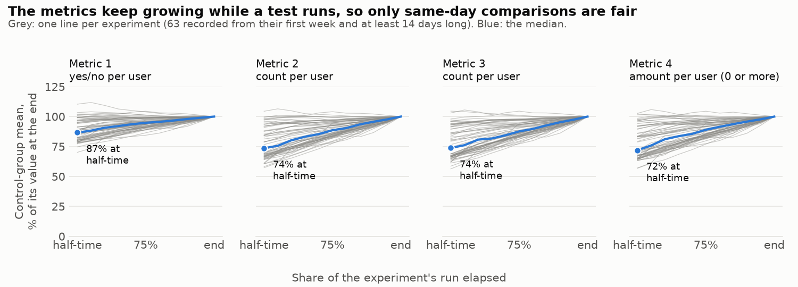
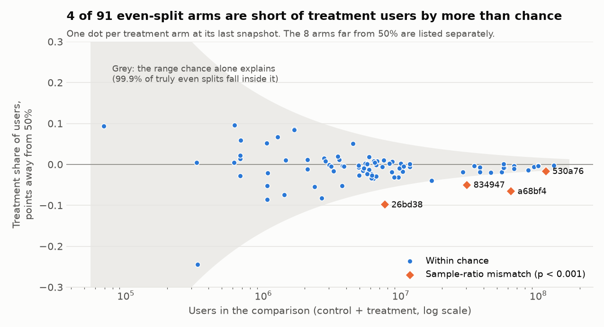
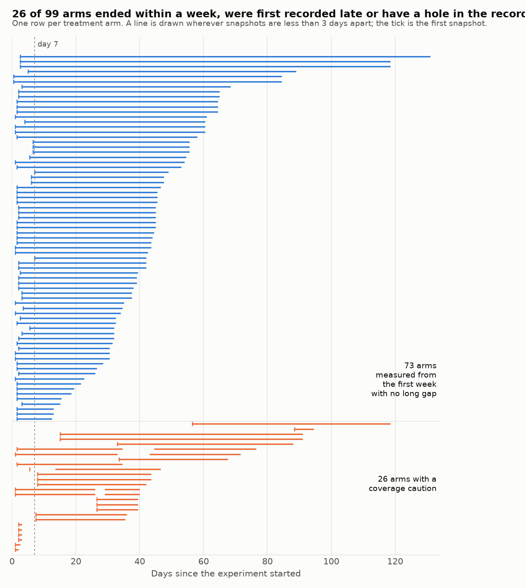

# Part 1: can these experiments be read at all?

*Generated by `scripts/data_checks_report.py` from the committed source file. Every number below is computed by the script; nothing is typed in by hand.*

Before anyone looks at whether a treatment won, three questions decide whether the experiment can be trusted: did each group get the users it was meant to get, did that stay true while the test ran, and was the test measured for long enough. This report asks them of all 78 experiments in the ASOS Digital Experiments Dataset.

**Headline:** 62 of the 99 treatment arms (50 of 78 experiments) pass every check. The other 37 carry at least one caution, listed in section 6, and each caution says what it rules out.

## 1. What is in the file

- **Source:** [asos_digital_experiments_dataset.csv](https://osf.io/64jsb/), CC BY 4.0, SHA-256 `aa0cc3f8304fac54…` (pinned in `abtest/source.py`).
- **24,153 rows.** One row is one experiment × treatment arm × metric × snapshot time. It holds the number of users, the mean and the variance for the control group and for that treatment group, all cumulative since the experiment started. There are no user-level rows.
- **78 experiments, 99 treatment arms.** 61 experiments have one treatment, 14 have two, 2 have three and 1 has four. In the 17 experiments with more than one treatment, every arm is compared with the same control group.
- **Size.** The smallest comparison has 69,123 users (control plus treatment), the median 6.1 million and the largest 129.6 million; 90 of the 99 arms have at least a million.
- **Length.** The shortest experiment's last snapshot is on day 2, the median on day 43.5 and the longest on day 131.
- **Cadence.** 3,912 of the 5,940 steps between snapshots are 12 hours and 1,997 are one day; the rest are longer.
- **Not in the file:** experiment names, dates, what was changed, the metric names, and the intended traffic split. The source's datasheet also says the experiments are not representative of ASOS's business. So this project can show how to read experiments like these; it cannot say anything about ASOS.

Structural rules, checked in DuckDB SQL ([`sql/integrity.sql`](../sql/integrity.sql)):

| Check | Rule | Breaks the rule |
| --- | --- | ---: |
| `arms_without_four_metrics` | every arm reports metrics 1 to 4 | 0 |
| `binary_metric_out_of_range` | metric 1 is a share between 0 and 1 | 0 |
| `binary_variance_mismatch` | metric 1 variance equals mean x (1 - mean) | 0 |
| `control_differs_between_arms` | arms of one experiment are compared with the same control group | 0 |
| `duplicate_keys` | experiment, arm, metric and time identify a row | 0 |
| `empty_groups` | both groups have at least one user | 8 |
| `missing_means` | every row has both means | 0 |
| `negative_means` | no metric is negative on average | 0 |
| `non_integer_user_counts` | user counts are whole numbers | 0 |
| `rows_missing_variance` | every row has both variances | 779 |
| `snapshots_missing_a_metric` | every snapshot of an arm reports all four metrics | 1 |
| `user_count_falls` | cumulative user counts never fall from one snapshot to the next | 2 |
| `user_counts_differ_by_metric` | the four metrics of a snapshot share one pair of user counts | 0 |

Four rules are broken somewhere:

- `empty_groups`: the 8 rows are one snapshot (the first, at day 3) of experiment `64dc88`, where both arms report zero users. It is ignored.
- `snapshots_missing_a_metric`: one snapshot of `a4386f` reports metric 1 only.
- `rows_missing_variance`: 12 arms lack a variance for metrics 2 to 4 at some snapshot, and 5 of them still lack it at their last snapshot. Those 5 match the datasheet, which says 5 treatments are affected.
- `user_count_falls`: in 2 arms a cumulative user count is lower than at the previous snapshot, which cannot really happen. The checks below skip such a snapshot and count its users in the next interval.

Two more things show the snapshots come from a pipeline, not a clean ledger: 168 snapshots in 23 arms add no user to either group (most likely the figures were not refreshed), and 11 snapshots in 8 arms add users to one group only.

## 2. The four metrics

The source does not name the metrics. Its schema says only this: metric 1 takes yes/no responses, metrics 2 and 3 are counts, metric 4 is a non-negative real number, and metrics 2 to 4 are right-skewed. This project uses those descriptions and does not guess at names such as "conversion" or "revenue".

| Metric | What the source says | Lowest control mean | Median | Highest | Median SD ÷ mean | Arms with no variance at the end | Median mean at half-time, % of final |
| --- | --- | ---: | ---: | ---: | ---: | ---: | ---: |
| 1 | yes/no per user | 0.026 | 0.197 | 0.772 | 2.02 | 0 | 87% |
| 2 | count per user | 0.029 | 0.332 | 2.123 | 2.75 | 5 | 74% |
| 3 | count per user | 0.086 | 1.074 | 5.966 | 3.23 | 5 | 74% |
| 4 | amount per user (0 or more) | 1.988 | 24.196 | 148.194 | 3.43 | 5 | 72% |

*Control group at each arm's last snapshot ([`sql/metric_profile.sql`](../sql/metric_profile.sql)). SD ÷ mean is the standard deviation divided by the mean. The last column uses the 63 experiments that were recorded from their first week and ran at least 14 days.*

Three things follow.

- **Metric 1 is a share of users.** Its variance equals mean × (1 − mean) in every row (`binary_variance_mismatch` is 0), so each user is a yes or a no and the mean is the share of users with a yes.
- **Metrics 2 to 4 are noisier.** The median SD ÷ mean rises from 2.02 for metric 1 to 3.43 for metric 4. For the same number of users, the same relative change is harder to detect on metric 4. Part 2 turns this into a required sample size.
- **The metrics keep growing while the test runs.** The figures are cumulative, so the longer the test has run, the more each user has had time to do. At half-time the median control mean is 87% of its final value for metric 1 and 72% for metric 4. It is below the final value in 57 of 63 experiments for metric 1 and 60 of 63 for metric 4, so this is the rule but not without exceptions. A treatment mean on day 28 must never be compared with a control mean on day 14, and an effect in absolute units depends on when the test stopped.

## 3. Did each group get its share of users?

If a test is meant to split users evenly and one group ends up with fewer, some users went missing after assignment (a redirect that fails, a slower page that loses impatient visitors, a tracking bug). Those missing users are rarely typical, so the comparison of the two groups is no longer fair. This is a **sample-ratio mismatch**, and it is checked before any metric.

The test is a chi-square test of the final user counts against an even split, with the usual alarm level of p < 0.001. The intended split is not published, so the result is read in three bands:

| Band | Rule | Arms |
| --- | --- | ---: |
| Even | no alarm | 87 |
| Sample-ratio mismatch | alarm, treatment share within half a point of 50% | 4 |
| Unequal split | alarm, treatment share more than half a point from 50% | 8 |

A reader who tests every arm against 50/50 and stops there gets 12 alarms. Only 4 of them look like users going missing.

**The 4 mismatches.** In each, the test was almost certainly meant to be even, and the treatment group is short by 7,454 to 41,070 users:

| Experiment / arm | Users | Treatment share | Treatment users short of 50% | p-value | Split over time |
| --- | ---: | ---: | ---: | ---: | --- |
| `a68bf4` / 1 | 62,947,482 | 49.935% | 41,070 | < 1e-15 | stable |
| `834947` / 1 | 30,113,549 | 49.950% | 14,920 | 5.4e-08 | stable |
| `26bd38` / 1 | 7,612,484 | 49.902% | 7,454 | 6.5e-08 | drifting |
| `530a76` / 1 | 112,933,005 | 49.984% | 18,290 | 5.8e-04 | stable |

The imbalances are small: the lowest treatment share is 49.902%. They are flagged because these tests are so large that chance cannot explain even that. Whether so few missing users could move a metric depends on who they were, which the file cannot show. Part 2 will read these arms with a warning.

**The 8 unequal splits.** These are too far from 50% to be lost users in an even test. Either the test was designed with an unequal split, or it is badly broken; the data alone cannot say which.

| Experiment / arm | Treatments in the experiment | Users | Treatment share | Named design that fits | Split over time |
| --- | ---: | ---: | ---: | --- | --- |
| `54a85a` / 0 | 3 | 3,422,852 | 2.99% | none | stable |
| `c3d89d` / 2 | 2 | 10,756,802 | 46.16% | none | stable |
| `329386` / 2 | 2 | 7,667,095 | 49.24% | 34:33 | stable |
| `64dc88` / 2 | 2 | 27,704,731 | 49.24% | 34:33 | stable |
| `329386` / 1 | 2 | 7,669,778 | 49.25% | 34:33 | stable |
| `64dc88` / 1 | 2 | 27,712,053 | 49.26% | 34:33 | stable |
| `eeefa3` / 3 | 2 | 2,124,634 | 66.64% | 1:2 | stable |
| `81761c` / 2 | 2 | 16,567,121 | 88.67% | none | drifting |

Two designs were checked by name: a treatment given twice the control's traffic (1:2), and a three-way 34/33/33 split, where each treatment has 33 users for the control's 34. 5 of the 8 arms are consistent with one of them (p ≥ 0.001 against that design). That is an inference from the counts, not a fact from the source. The list of named designs was kept to two on purpose: with enough candidates, some ratio always fits.

## 4. Did the split hold while the test ran?

A check that needs no knowledge of the intended split: among the *new* users of each interval, the treatment share should be the same from start to finish. It is tested between snapshots (intervals with fewer than 1,000 new users pooled) and again between whole weeks.

- **Stable:** 93 arms.
- **Timing only:** 2 arms differ between snapshots but not between weeks. That is the pattern expected when one group's count is refreshed before the other's and the next snapshot catches up.
- **Drifting:** 4 arms differ between weeks.

| Experiment / arm | Verdict | p-value between snapshots | p-value between weeks | Weekly treatment share, lowest | highest |
| --- | --- | ---: | ---: | ---: | ---: |
| `26bd38` / 1 | drifting | 0.001 | 2.2e-05 | 49.78% | 50.05% |
| `81761c` / 2 | drifting | < 1e-15 | < 1e-15 | 88.16% | 88.85% |
| `c4df76` / 1 | drifting | 0.020 | 3.5e-04 | 49.94% | 50.05% |
| `cf1b96` / 1 | drifting | 0.002 | 1.2e-04 | 49.99% | 51.76% |
| `6f8a33` / 1 | timing only | < 1e-15 | 0.267 | 49.90% | 50.13% |
| `a4386f` / 1 | timing only | < 1e-15 | 0.470 | 49.92% | 50.09% |

The drifts are small in size. They are flagged because a split that moves suggests the traffic allocation, or the tracking, changed during the test.

A note on the alarm level: with 99 arms tested at p < 0.001, about 0.1 false alarms are expected per check if nothing were wrong, so chance alone does not explain these flags (but see the note on lumpy traffic in section 7). The opposite error cannot be ruled out: an arm with no flag is not proven clean.

## 5. Was each test measured for long enough?

- **Under a week:** 6 arms in 3 experiments end before day 7. Shopping differs between weekdays and weekends, so a test that has not seen every day of the week is too short to decide on, however many users it has.
- **First week not recorded:** 14 arms in 10 experiments have their first snapshot after day 7 (the latest starts on day 88.5). The final result is still readable. What cannot be replayed is what someone checking daily would have seen in the first days, which matters for Part 3.
- **Gap in snapshots:** 6 arms have 3 or more days with no snapshot (the longest gap is 15 days).

## 6. What goes into Part 2

| Caution | Rule | Arms | What it means for the readout |
| --- | --- | ---: | --- |
| sample-ratio mismatch | Treatment share within half a point of 50%, but further from it than chance allows (p < 0.001) | 4 | Read with a warning; never as the only evidence for a launch |
| unequal split | Treatment share more than half a point from 50% | 8 | Readable only against the intended split, which the source does not publish |
| split drifts | Treatment share of new users differs between weeks (p < 0.001) | 4 | Read with a warning |
| under a week | Last snapshot before day 7 | 6 | Too short to decide on |
| first week not recorded | First snapshot after day 7 | 14 | The end result is readable; what a daily look would have shown early on is not |
| gap in snapshots | 3 or more days with no snapshot | 6 | The end result is readable; the daily path has a hole |
| variance missing | No variance for at least one metric at the last snapshot | 5 | Metric 1 is readable; the metrics without a variance cannot be tested |

An arm can carry more than one caution; 37 arms carry at least one and 62 carry none. The full list is in [`arm_checks.csv`](arm_checks.csv), one row per arm with every figure used above.

**So what, for a team that runs experiments:**

1. **Check the split before the metrics, and against the intended split.** Testing everything against 50/50 raised 12 alarms here, and 8 of them are too far from 50% to be an even test that lost a few users. The intended allocation belongs in the experiment record, next to the results.
2. **A sample-ratio alarm in a very large test can be a very small imbalance.** The largest shortfall here is 41,070 users out of 62.9 million. Report the size with the alarm, so the decision is about what the missing users could have changed, and not about a p-value.
3. **Do not decide on a test shorter than a week,** and keep the daily record complete: 26 of 99 arms here are too short, start late or have a hole in the record.
4. **Never compare metrics across different days of a test.** They are cumulative, and at half-time the typical control mean is at roughly 72% to 87% of its final level.

## 7. Limits

- The intended split, the dates and the metric names are not published. Every statement about design is an inference and is labelled as one.
- The alarm level (p < 0.001), the half-point band, the 7-day rules and the 3-day gap are working choices, set in `abtest/checks.py`. They were chosen after looking at the data, so the counts in section 6 would shift a little with other choices.
- The checks use user counts only. They can show that a split is off; they cannot show why, or which users are missing.
- The chi-square tests treat users as independent. Real traffic is lumpier than that (the source cannot show how much), so the p-values are somewhat too small, most of all for the largest tests.
- An arm with no caution has passed these checks only. Problems that leave the user counts untouched, such as a metric logged wrongly in one group, are invisible here.
