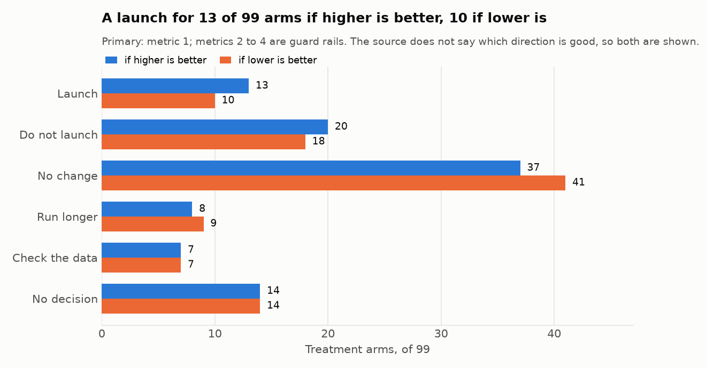
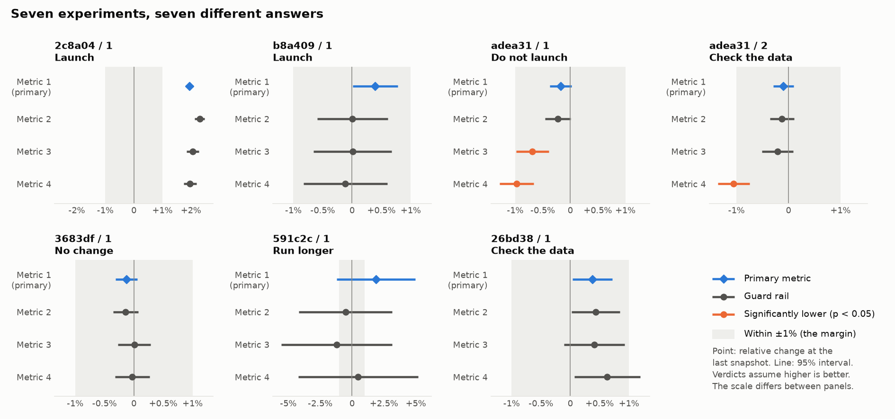

# Part 4: the decision memo

*Generated by `scripts/decision_report.py` from the committed source file. Every number below is computed by the script; the wording of each recommendation is fixed per kind of case and filled in from that case's own figures.*

**To:** the product team. **Question:** which of these treatments do we launch?

**Short answer:** of 99 treatments tested, **13 pass every rule for a launch** if a higher metric 1 is better (10 if lower is better). 20 should not be launched, 37 changed nothing worth having, 8 could not tell, and 21 are not decided: 14 for an unexplained split or too short a run, 7 held for a data check. The source does not say what the metrics are or which direction is good, so every verdict below is given both ways; 61 of the 99 verdicts are the same either way.

## 1. The rules

One metric is the **primary**: the one the test was run to move, named before the test. The others are **guard rails**: nobody expects them to improve, but a launch must not make them worse. Here the primary is metric 1 (yes/no per user) and metrics 2 to 4 are guard rails. That is a working choice, since the source names nothing; section 5 shows what changes with another choice.

Applied to each treatment arm in this order ([`abtest/decision.py`](../abtest/decision.py)):

1. **No decision** if Part 1 could not explain the split or the test ran under a week.
2. **Check the data** if Part 1 warned about the split, or the last snapshot of any metric jumps by more than 3 standard errors from the look before it (Part 3).
3. **Do not launch** if the primary is significantly worse (p < 0.05), or any guard rail is.
4. **Launch** if the primary is significantly better, also after Holm's correction across the treatment arms of the experiment, and every guard rail's 95% interval rules out a loss of 1% or more.
5. **Run longer** if the primary is better but a guard rail is not cleared or cannot be tested.
6. **No change** if the primary's interval lies inside ±1%.
7. **Run longer** otherwise: the test could not tell.

Three choices in those rules are deliberate:

- **Good news has a higher bar than bad news.** A launch needs the primary to survive a correction for the number of arms; an uncorrected p < 0.05 in the wrong direction on any metric is enough to stop one. A false alarm on a guard rail costs a delayed launch. A missed one costs a loss that ships.
- **A guard rail is cleared by its interval, not by "not significant".** "Not significant" is also what a test too small to see anything reports. A guard rail is cleared only when its interval rules out a loss of 1%.
- **The primary is one metric, so it needs no correction across metrics.** That is what naming it in advance buys (Part 2).

## 2. What the rules decide

| Verdict | What it means | If higher is better | If lower is better |
| --- | --- | ---: | ---: |
| Launch | Primary better, every guard rail cleared, data sound | 13 | 10 |
| Do not launch | Primary worse, or a guard rail worse | 20 | 18 |
| No change | Primary inside ±1% and no guard rail worse | 37 | 41 |
| Run longer | The test cannot tell: too small, or a guard rail not cleared | 8 | 9 |
| Check the data | A split warning (Part 1) or a suspect last snapshot (Part 3) | 7 | 7 |
| No decision | Unexplained split or under a week of data (Part 1) | 14 | 14 |

Every arm and its verdict both ways: [`decisions.csv`](decisions.csv).

**From "significant" to "launch".** Taking higher as better:

- 16 of 99 arms end with the primary higher at p < 0.05. That is the list a dashboard would show.
- 1 is in an arm Part 1 would not decide on (an unexplained split or under a week of data), and 1 is held for a data check.
- 1 is one of several treatments in its experiment and does not survive the correction for that.
- None is stopped by a guard rail.
- **13 are left.** Their gains run from +0.27% to +2.97%, with a median of +0.57%; 8 of the 13 are under 1%.

The rule Part 2 warned about, "launch if any of the four metrics is significantly higher", would pick 20 of the 85 arms Part 2 read.

**What the guard rails did.** They never stopped a launch: in all 14 arms where the primary is better (the 13 launches and 1 held for a data check), no guard rail is worse and every one is cleared. These four metrics move together (Part 2), so a treatment that lifts one rarely lowers another. The guard rails earned their place among the quiet tests instead:

- **10 arms have a primary that is not significantly different and a guard rail that is significantly worse.** In 8 of them the primary's interval is inside ±1%, so a readout of the primary alone would say "no change, safe to launch if there is another reason to". The guard rails say it is not safe.
- Together with the 10 arms whose primary is worse, that makes 20 "do not launch" verdicts. A team reading only the primary would have seen 10 of them.
- If lower is better the picture is the same with different arms: 14 with a worse primary, 4 with a worse guard rail.

**How solid are the 13 launches?** The rules above read each test once, at its end. That is sound if the end date was fixed before the test; the source does not say whether it was. Part 3's always-valid rule is the check that does not depend on that:

- 11 of the 13 have a complete daily record. The always-valid rule, confirmed on the next look, called **8** of them, on a median of day 7.25.
- The confirmed rule did not call the other 3. Those 3 are launches only if their end date was planned (case 2 below is one).
- The remaining 2 could not be replayed (their daily record is incomplete).

**The last-snapshot check, on every test.** Part 3 ran its check for a suspect final snapshot only on the 265 tests it replayed. A decision needs it everywhere, so it is run here on all 325 tests Part 2 read (60 more). It finds 1: `adea31` / 2, metric 4, the one Part 3 had already found. No other final snapshot is suspect by this rule.

## 3. Seven decisions, written out

The seven arms are picked by rule, not by eye, from the "higher is better" verdicts: the launch with the smallest primary p-value; the launch with the largest; the "guard rail worse" arm with the smallest guard-rail p-value; the arm whose last snapshot jumps; the "no change" arm with the narrowest primary interval; the "too wide" arm with the largest detectable change; and the arm with a split warning and the smallest primary p-value.

| # | Case | Arm | If higher is better | If lower is better |
| --- | --- | --- | --- | --- |
| 1 | A clear result | `2c8a04` / 1 | launch | do not launch |
| 2 | A result on thin evidence | `b8a409` / 1 | launch | do not launch |
| 3 | A flat primary that hides a loss | `adea31` / 1 | do not launch | no change |
| 4 | A result that rests on one snapshot | `adea31` / 2 | check the data | check the data |
| 5 | A test that found nothing, and can say so | `3683df` / 1 | no change | no change |
| 6 | A test too small to say anything | `591c2c` / 1 | run longer | run longer |
| 7 | A result from a test with a broken split | `26bd38` / 1 | check the data | check the data |

### 1. A clear result: `2c8a04` / 1

**Recommendation: launch.** The primary is up +1.94% (+1.81% to +2.08%), and all three guard rails moved the same way. The split is clean and the test ran 131 days. A team looking every day under the always-valid rule would have had this answer on day 7.5.

**Plan on** the interval, not the point: a gain between +1.81% and +2.08%.

**What would change this:** nothing in the data. The open question is the one the data cannot answer: what metric 1 is.

**If lower is better:** do not launch (primary worse).

| Metric | Role | Change | 95% interval | p | Reads as |
| --- | --- | ---: | ---: | ---: | --- |
| 1: yes/no per user | primary | +1.94% | +1.81% to +2.08% | < 1e-15 | better |
| 2: count per user | guard rail | +2.31% | +2.13% to +2.48% | < 1e-15 | cleared |
| 3: count per user | guard rail | +2.06% | +1.85% to +2.28% | < 1e-15 | cleared |
| 4: amount per user (0 or more) | guard rail | +1.97% | +1.74% to +2.20% | < 1e-15 | cleared |

- Users: 64,817,937 control, 64,812,440 treatment (treatment share 50.00%). Ran 131 days. Treatment arms in this experiment: 1.
- Part 1 cautions: none.
- Daily looks (Part 3): the always-valid rule, confirmed on the next look, called the primary on day 7.5, when the change read +2.90%.
- Blips in the daily record (all metrics): 3.

### 2. A result on thin evidence: `b8a409` / 1

**Recommendation: launch only if the end date was fixed before the test started.** The primary is up +0.39% with p = 0.043: it passes the rule, narrowly, and the lower end of the interval (+0.01%) is close to no gain at all. The guard rails are cleared. The always-valid rule never called this result in 64.5 days of daily looks, so if the test ended when it did because someone liked the number that day, p = 0.043 is not evidence (Part 3).

**Plan on** a gain that may be close to zero. This test could reliably detect a change of 0.55%; the one it reports is 0.39%.

**What would change this:** a planned end date on record turns this into a launch. Without one, repeat the test.

**If lower is better:** do not launch (primary worse).

| Metric | Role | Change | 95% interval | p | Reads as |
| --- | --- | ---: | ---: | ---: | --- |
| 1: yes/no per user | primary | +0.39% | +0.01% to +0.78% | 0.043 | better |
| 2: count per user | guard rail | +0.01% | -0.59% to +0.61% | 0.983 | cleared |
| 3: count per user | guard rail | +0.01% | -0.66% to +0.68% | 0.979 | cleared |
| 4: amount per user (0 or more) | guard rail | -0.11% | -0.83% to +0.60% | 0.755 | cleared |

- Users: 1,626,478 control, 1,625,384 treatment (treatment share 49.98%). Ran 64.5 days. Treatment arms in this experiment: 1.
- Part 1 cautions: none.
- Daily looks (Part 3): the always-valid rule never called the primary.

### 3. A flat primary that hides a loss: `adea31` / 1

**Recommendation: do not launch.** On the primary alone this is a quiet test: -0.17%, p = 0.083, interval inside ±1%. A readout that stopped there would file it as "no change". The guard rails say otherwise: metric 3 is down 0.69% (p = 6.3e-06), metric 4 is down 0.98% (p = 7.1e-10). A change that leaves the primary where it was and lowers two other metrics is a loss.

**What would change this:** learning that lower is better for those metrics (see below), or that they do not matter to this product area.

**If lower is better:** no change (primary inside the margin, no guard rail worse).

| Metric | Role | Change | 95% interval | p | Reads as |
| --- | --- | ---: | ---: | ---: | --- |
| 1: yes/no per user | primary | -0.17% | -0.37% to +0.02% | 0.083 | no change |
| 2: count per user | guard rail | -0.23% | -0.46% to +0.01% | 0.060 | cleared |
| 3: count per user | guard rail | -0.69% | -0.98% to -0.39% | 6.3e-06 | worse |
| 4: amount per user (0 or more) | guard rail | -0.98% | -1.28% to -0.67% | 7.1e-10 | worse |

- Users: 49,736,188 control, 49,732,341 treatment (treatment share 50.00%). Ran 84.5 days. Treatment arms in this experiment: 2.
- Part 1 cautions: none.
- Daily looks (Part 3): the always-valid rule never called the primary.
- Blips in the daily record (all metrics): 2.

### 4. A result that rests on one snapshot: `adea31` / 2

**Recommendation: do not decide yet. Ask the data team about the last snapshot.** This is the second treatment of the experiment in the case before. Its primary is flat (-0.10%, p = 0.328), and metric 4 ends -1.05% with p = 2.7e-11, which on its own would be a clear "do not launch". That figure comes from a final snapshot that moved by more than 3 standard errors from the day before. One more day of users almost never moves a test of this size that far (Part 3's simulation); Part 3 found 5 blips elsewhere in this arm's record. No later snapshot exists to show whether the figure jumps back.

**What would change this:** one more snapshot, or the pipeline's log for the last day. If the figure holds, the verdict is "do not launch", as for the other treatment. Either way the treatment is not launched today.

**If lower is better:** the same verdict (check the data).

| Metric | Role | Change | 95% interval | p | Reads as |
| --- | --- | ---: | ---: | ---: | --- |
| 1: yes/no per user | primary | -0.10% | -0.29% to +0.10% | 0.328 | no change |
| 2: count per user | guard rail | -0.12% | -0.36% to +0.11% | 0.300 | cleared |
| 3: count per user | guard rail | -0.21% | -0.51% to +0.09% | 0.167 | cleared |
| 4: amount per user (0 or more) | guard rail | -1.05% | -1.36% to -0.74% | 2.7e-11 | worse |

- Users: 49,736,188 control, 49,728,942 treatment (treatment share 50.00%). Ran 84.5 days. Treatment arms in this experiment: 2.
- Part 1 cautions: none.
- Daily looks (Part 3): the always-valid rule never called the primary.
- Blips in the daily record (all metrics): 5.
- Last snapshot: metric 4 jumps by more than 3 standard errors from the look before it.

### 5. A test that found nothing, and can say so: `3683df` / 1

**Recommendation: do not launch for the metrics; the test found no change.** The primary moved -0.13% and its interval (-0.31% to +0.06%) rules out a change of 1% in either direction. Every guard rail is cleared. With 93,059,003 users this is a finding, not a shrug: the idea does not move metric 1 by an amount worth having.

**What would change this:** a reason to launch that is not a metric (lower cost, simpler code, a legal requirement). The test says such a launch would be safe to within 1%.

**If lower is better:** the same verdict (no change).

| Metric | Role | Change | 95% interval | p | Reads as |
| --- | --- | ---: | ---: | ---: | --- |
| 1: yes/no per user | primary | -0.13% | -0.31% to +0.06% | 0.184 | no change |
| 2: count per user | guard rail | -0.14% | -0.35% to +0.08% | 0.208 | cleared |
| 3: count per user | guard rail | +0.01% | -0.27% to +0.29% | 0.950 | cleared |
| 4: amount per user (0 or more) | guard rail | -0.03% | -0.32% to +0.27% | 0.858 | cleared |

- Users: 46,535,521 control, 46,523,482 treatment (treatment share 49.99%). Ran 68.5 days. Treatment arms in this experiment: 1.
- Part 1 cautions: none.
- Daily looks (Part 3): the always-valid rule never called the primary.
- Blips in the daily record (all metrics): 5.

### 6. A test too small to say anything: `591c2c` / 1

**Recommendation: the test cannot tell, and running it longer is not realistic.** The primary reads +1.87%, but the interval runs from -1.22% to +4.96%: a gain of several percent and a loss of more than 1% both fit. The smallest change this test could reliably detect is 4.4%, more than the largest significant change in any test here (3.78%, Part 2).

**What it would take:** about 656,369 users per group to detect a 1% change; the smaller group had 34,497. At the rate this test ran, that is roughly 238 days; the longest test in this dataset ran 131. So either the change being tested has to be one that could plausibly move the metric by 4% or more, or the decision has to be made on other grounds, and said to be.

**What would change this:** only more users.

**If lower is better:** the same verdict (run longer).

| Metric | Role | Change | 95% interval | p | Reads as |
| --- | --- | ---: | ---: | ---: | --- |
| 1: yes/no per user | primary | +1.87% | -1.22% to +4.96% | 0.230 | too wide |
| 2: count per user | guard rail | -0.51% | -4.17% to +3.15% | 0.784 | not cleared |
| 3: count per user | guard rail | -1.20% | -5.55% to +3.15% | 0.591 | not cleared |
| 4: amount per user (0 or more) | guard rail | +0.47% | -4.23% to +5.17% | 0.843 | not cleared |

- Users: 34,497 control, 34,626 treatment (treatment share 50.09%). Ran 12.5 days. Treatment arms in this experiment: 1.
- Part 1 cautions: none.
- Daily looks (Part 3): the always-valid rule never called the primary.

### 7. A result from a test with a broken split: `26bd38` / 1

**Recommendation: do not decide. Find out why the split is off, then rerun.** The primary is up +0.38% with p = 0.028, which would be good news in a sound test. Part 1 found the treatment group 14,908 users smaller than the control group (treatment share 49.902%, p = 6.5e-08 against an even split) and a split that drifts from week to week. That gap is 0.39% of the treatment group. If the missing users were all ones with a "no" on metric 1, their absence alone would raise the treatment's figure by 0.39%: as much as the whole result.

**What would change this:** an explanation for the missing users that has nothing to do with how they behaved. Without one, the result is not evidence.

**If lower is better:** the same verdict (check the data).

| Metric | Role | Change | 95% interval | p | Reads as |
| --- | --- | ---: | ---: | ---: | --- |
| 1: yes/no per user | primary | +0.38% | +0.04% to +0.71% | 0.028 | better |
| 2: count per user | guard rail | +0.43% | +0.02% to +0.84% | 0.038 | cleared |
| 3: count per user | guard rail | +0.41% | -0.11% to +0.92% | 0.119 | cleared |
| 4: amount per user (0 or more) | guard rail | +0.63% | +0.07% to +1.19% | 0.028 | cleared |

- Users: 3,813,696 control, 3,798,788 treatment (treatment share 49.90%). Ran 46.5 days. Treatment arms in this experiment: 1.
- Part 1 cautions: sample-ratio mismatch; split drifts; gap in snapshots.
- Daily looks (Part 3): not replayed, the daily record is incomplete.

## 4. Which direction is good?

The source does not say, and it decides the answer.

- **61 of 99 verdicts do not depend on it:** every "no decision" and "check the data", and the tests in which no metric is significantly different.
- **All 13 launches become "do not launch"** if lower is better, because the metric that rose is then the metric that got worse.
- The verdicts apply one direction to all four metrics. If the primary were better higher and a guard rail better lower (a cost, a return rate), a treatment that raises everything would be a launch with a guard-rail loss. Since these metrics move together, that would happen often here. Only the metric definitions can settle it.

## 5. Does the choice of primary or margin matter?

Verdicts if each metric in turn were the primary (higher is better; the other three are guard rails):

| Primary metric | Launch | Do not launch | No change | Run longer | Check the data | No decision |
| --- | ---: | ---: | ---: | ---: | ---: | ---: |
| 1: yes/no per user | 13 | 20 | 37 | 8 | 7 | 14 |
| 2: count per user | 10 | 20 | 38 | 6 | 6 | 19 |
| 3: count per user | 9 | 20 | 36 | 9 | 6 | 19 |
| 4: amount per user (0 or more) | 12 | 20 | 32 | 10 | 6 | 19 |

- Of the 78 arms that get a verdict on the metrics with metric 1 as primary, 57 get the same verdict whichever metric is the primary.
- 17 arms would be a launch under at least one choice of primary, 7 under every choice. A team that picks the primary after seeing the results has the larger number to choose from.
- The "do not launch" count does not move, because a metric that is significantly worse stops a launch whether it is the primary or a guard rail.
- With metrics 2 to 4 as primary, 5 more arms get no decision: the source has no variance for those metrics in those arms.

Verdicts for different margins (primary metric 1, higher is better):

| Margin | Launch | Do not launch | No change | Run longer | Check the data | No decision |
| --- | ---: | ---: | ---: | ---: | ---: | ---: |
| ±0.5% | 12 | 20 | 26 | 20 | 7 | 14 |
| ±1% | 13 | 20 | 37 | 8 | 7 | 14 |
| ±2% | 13 | 20 | 43 | 2 | 7 | 14 |

The margin moves arms between "no change" and "run longer" and leaves the rest almost untouched. It is a business number, the largest loss a launch may risk and the smallest gain worth having, and it should be set before the test, like the primary.

## 6. So what, for a team that runs experiments

1. **Write the decision rule before the test.** Primary metric, direction, guard rails, margin, end date. Every one of those is missing from this dataset, and each one changes verdicts: the direction changes 38 of 99, the choice of primary changes 21 of 78.
2. **"Significant" is where the decision starts.** 16 arms show a significantly higher primary; 13 are launches. The rest fall at the steps in between (section 2).
3. **Guard rails matter most when the primary is quiet.** 10 arms looked like "nothing happened" on the primary and had a significantly worse guard rail. Read every guard rail on every test, including the ones nobody is excited about.
4. **Separate "no change" from "cannot tell".** 37 tests rule out a change of 1%: a finding, and the idea can be closed. 8 cannot tell, and for the smallest of them no realistic amount of extra time would help (case 6). Check the detectable change before starting a test.
5. **A verdict is only as good as the last snapshot.** One strong result here rests on a final figure that jumped (case 4). Hold the decision one day when the last look disagrees with the one before.
6. **A launch decided on a fixed end date and a launch decided by daily looks are different claims.** 8 of the 11 launches with a daily record hold under a rule built for daily looks; 3 depend on the end date having been planned. Record which it was.

## 7. Limits

- The primary (metric 1), the direction and the 1% margin are working choices made for this exercise. The source publishes none of them, so no verdict here is a statement about what ASOS did or should have done.
- One direction is applied to all four metrics; mixed directions are not modelled (section 4).
- The verdicts read each test once, at its last snapshot, as if the end date had been fixed in advance. Section 2 says which launches also hold under daily looks.
- Guard rails are checked at an uncorrected p < 0.05, three per arm, so some "guard rail worse" verdicts are false alarms: up to 14% of arms would show one if nothing changed and the metrics were independent. That is the price of a low bar for bad news.
- "Run longer" assumes the test could be extended. The source gives no dates, traffic plans or costs.
- The last-snapshot check cannot judge an arm's first look, misses smaller faults, and was tuned on this data (Part 3).
- The metrics are cumulative and unnamed, so no change can be given a money value, and a gain at the end of a test may not be the gain after a launch.
- The seven cases are chosen to show seven kinds of answer. They are not a sample of the 99 arms.
