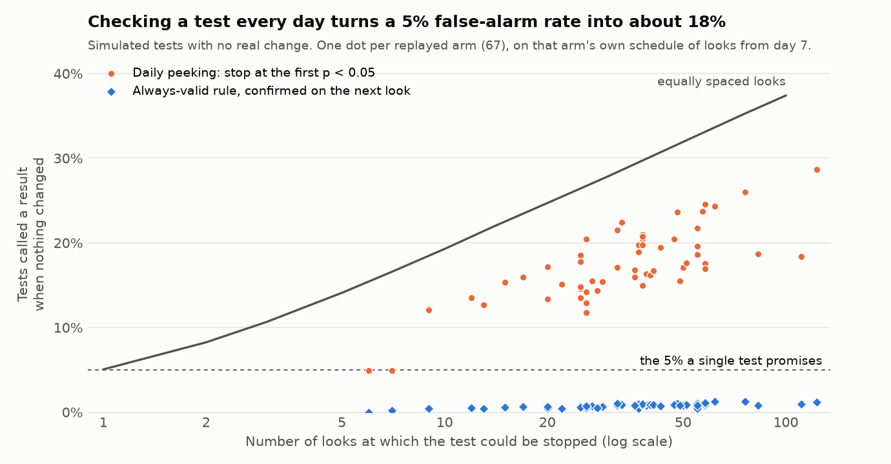
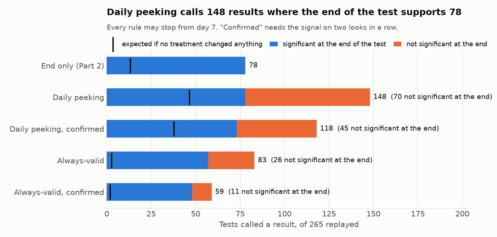
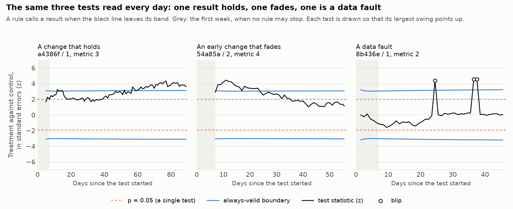

# Part 3: the cost of peeking

*Generated by `scripts/peeking_report.py` from the committed source file. Every number below is computed by the script; nothing is typed in by hand. The simulation is seeded, so a rerun gives the same figures.*

Part 2 read each test once, at its last snapshot. Real teams do not wait: the dashboard updates every day and someone looks. This part asks what that does. It replays each test as a series of daily looks, simulates tests in which nothing changed on the same schedule of looks, and tries a stopping rule that is built to be checked every day.

**Headline:** read once at the end, 78 of 265 tests are significant. A team that looked every day from day 7 and called a result at the first p < 0.05 would have called 148, and 70 of those are not significant when the test ends. In simulated tests where nothing changed, that habit calls a result 18% of the time, where a single test promises 5%. An always-valid rule, confirmed on the next look, brings the simulated rate down to 0.7% and calls 59 results, 48 of them significant at the end, a median of 24 days before the test finished.

As in Part 2, the metrics are not named, so nothing here is called a win or a loss.

## 1. What is replayed

- **A daily look** is the latest snapshot in each 24-hour window since the test started ([`sql/daily_looks.sql`](../sql/daily_looks.sql)), so an arm recorded every 12 hours and one recorded every 24 are both looked at once a day. A snapshot whose cumulative user count is lower than an earlier one is not a look.
- **67 of the 85 arms that Part 2 read are replayed** (59 experiments, 265 of Part 2's 325 tests). The other 18 are left out because their daily record is incomplete (Part 1): 12 were first recorded after day 7 and 6 have a gap of three days or more.
- That gives 11,687 looks. A test has a median of 43 looks (11 to 128) and ran for a median of 44.5 days.
- **No rule may stop a test before day 7.** Part 1's rule that a test must see every day of the week applies to every rule below. The last look always counts as a decision.
- At every look the test is the one Part 2 used (Welch's t-test; relative change with a delta-method standard error). At the last look the figures equal Part 2's.

## 2. What looking every day does when nothing changed

A p-value below 0.05 happens by chance in 5% of tests in which nothing changed. That is the promise of one test. Each extra look is another chance, and the looks are not independent, so the chances do not simply add; a simulation shows what they come to.

With equally spaced looks and no real change, calling a result at the first p < 0.05 gives (200,000 simulated tests per row):

| Looks | False-alarm rate |
| --- | ---: |
| 1 | 5.1% |
| 2 | 8.2% |
| 3 | 10.6% |
| 5 | 14.1% |
| 7 | 16.6% |
| 10 | 19.3% |
| 14 | 22.0% |
| 20 | 24.7% |
| 30 | 27.8% |
| 50 | 31.9% |
| 75 | 35.2% |
| 100 | 37.4% |

For the experiments here, the simulation uses each arm's own schedule: the day of every look and the share of its final users it had by then (20,000 simulated tests per arm, [`peeking_null_by_arm.csv`](peeking_null_by_arm.csv)).

- **Daily peeking from day 7 calls a false result in 17.6% of no-change tests on average** (4.9% to 28.6% depending on the arm's schedule). That is 3.5 times the 5% a single test promises.
- **Waiting for a second look in a row helps a little:** 14.3%. Two looks a day apart share almost all their users, so the second mostly repeats the first.
- **The always-valid rule stays under 5%:** 1.1% on average (at most 1.9%), and 0.7% when confirmed on the next look. It is stricter than it needs to be on these schedules, which costs some sensitivity (section 5).

## 3. The rule that can be checked every day

The always-valid rule ([`abtest/peeking.py`](../abtest/peeking.py)) is the mixture sequential probability ratio test. At each look it computes one number, the *evidence ratio*: how much better the data fits "the treatment changed the metric by some amount" than "nothing changed", averaged over a spread of possible changes (a normal distribution with a standard deviation of 1% of the control mean, Part 2's reference change). It calls a result when the ratio reaches 20 (1 ÷ 0.05).

- The guarantee: if nothing changed, the chance that the ratio *ever* reaches 20 is at most 5%, however many times it is checked. It needs no planned end date and no planned number of looks.
- The price: its bar is higher than a single test's. A single test needs the difference to be 1.96 standard errors; the always-valid rule needs at least 3.04 at every look in these tests (a median of 3.06 at the first look where a decision is allowed).
- The spread (1%) changes how sensitive the rule is to changes of different sizes. It does not change the guarantee.

## 4. Snapshots that cannot be right

Replaying the looks turned up a data fault that Part 1's checks on user counts could not see.

- **50 blips, covering 64 looks.** A blip is a run of 1 to 3 looks at which the test statistic has jumped by more than 3 standard errors and after which it jumps back by more than 3. 41 of the 50 last a single look. They are in 22 tests of 18 arms: 1 in metric 1, 46 in metric 2, 1 in metric 3, 2 in metric 4.
- **Chance almost never does this.** A few days of new users are a small share of a test, so the statistic moves slowly from look to look. The simulated no-change tests have 3 looks in a blip out of 59,700,000; the real tests have 64 out of 11,687.
- The likely cause is a snapshot in which one group's metric had been updated and the other's had not. That is an inference from the pattern (mostly one metric, a few looks, then back to where it was); the source does not say.
- **A rule that acts on the first signal acts on these.** 16 of the 148 peeking results and 16 of the 83 always-valid results were called at a look inside a blip; 14 of those 16 are not significant at the end. The always-valid rule's higher bar is no defence, because a fault can be any size.
- **Asking for the signal on two looks in a row removes the one-look blips and no more.** 4 of the 59 confirmed always-valid results were still called inside a blip, one that lasted two or three looks. Confirmation is a cheap first defence (it costs a day); the real fix is in the pipeline, which should hold back a snapshot whose result jumps away from the day before.
- **A fault in the last snapshot cannot be confirmed**, because no later look shows whether it jumps back. In 1 of the 265 tests the last look is more than 3 standard errors away from the last look before it that is not in a blip: `adea31` / 2, metric 4 (final p = 2.7e-11). Part 2 reads that snapshot, so its figure for that test deserves a second look before anyone relies on it.

| Arm | Blips | Looks in a blip | Metrics affected | Days the test ran |
| --- | ---: | ---: | --- | ---: |
| `3683df` / 1 | 5 | 5 | 2, 4 | 68.5 |
| `adea31` / 2 | 5 | 6 | 2, 4 | 84.5 |
| `11cf0c` / 1 | 4 | 4 | 2 | 64.5 |
| `873d9d` / 1 | 4 | 6 | 2 | 45.5 |
| `162a38` / 1 | 3 | 3 | 1, 2, 3 | 42 |
| `2c8a04` / 1 | 3 | 9 | 2 | 131 |
| `7a99e4` / 1 | 3 | 3 | 2 | 45 |
| `7a99e4` / 2 | 3 | 3 | 2 | 45 |
| `a68bf4` / 1 | 3 | 3 | 2 | 30.5 |
| `e861d3` / 1 | 3 | 3 | 2 | 65 |
| `e861d3` / 2 | 3 | 3 | 2 | 65 |
| `39aed1` / 1 | 2 | 2 | 2 | 22.5 |
| `8b436e` / 1 | 2 | 3 | 2 | 45.5 |
| `8ed19a` / 1 | 2 | 4 | 2 | 44.5 |
| `adea31` / 1 | 2 | 3 | 2 | 84.5 |
| `1bacbe` / 1 | 1 | 1 | 2 | 45 |
| `530a76` / 1 | 1 | 1 | 2 | 54 |
| `c3d89d` / 1 | 1 | 2 | 2 | 39 |

## 5. The real tests, read every day

| Rule | Calls a result at | Tests called a result | Significant at the end | Not significant at the end | Expected if nothing changed | Simulated false-alarm rate |
| --- | --- | ---: | ---: | ---: | ---: | ---: |
| End only (Part 2) | one test at the last snapshot | 78 | 78 | 0 | 13 | 5.0% |
| Daily peeking | the first daily look with p < 0.05 | 148 | 78 | 70 | 47 | 17.6% |
| Daily peeking, confirmed | p < 0.05 on two looks in a row | 118 | 73 | 45 | 38 | 14.3% |
| Always-valid | the first daily look where the evidence ratio reaches 20 | 83 | 57 | 26 | 3 | 1.1% |
| Always-valid, confirmed | evidence ratio of 20 or more on two looks in a row | 59 | 48 | 11 | 2 | 0.7% |

"Expected if nothing changed" is the sum, over the 265 tests, of each test's simulated false-alarm rate. The comparison with the end of the test is a yardstick, not the truth: the final reading can be wrong as well.

- **Daily peeking calls 148 results where the end of the test supports 78.** It cannot miss a test that ends significant, because the last look is one of its looks (4 of the 148 are called only there); it adds 70 results that do not last. Of the 187 tests that end without a significant change, 70 (37%) showed p < 0.05 on at least one day.
- **By arm it is worse.** With four metrics and daily looks, 51 of 67 arms show a "significant" metric at some point, against 35 at the end.
- **A result called early is overstated.** For the 78 tests that peeking calls and that end significant, the change on the day it was called was larger than the final one in 63, by a median factor of 1.31. In 16 of the 148 peeking results the change even has the opposite sign to the final estimate (2 of them in tests that end significant).
- **The confirmed always-valid rule calls 59 results:** 48 of the 78 that are significant at the end, and 11 that are not. If nothing had changed in any test it would be expected to call about 2.
- **It decides early.** For those 48, the result came on a median of day 7.5 of a test that ran 34.5 days: 24 days sooner. The estimate on that day is still inflated (median factor 1.35 against the final one), so the size should be re-read at the end even when the decision is made early.
- **It misses 30 tests that end significant.** That is the price of the higher bar. Their final p-values have a median of 0.015, and 13 of them survive Part 2's correction for multiple metrics, so they are not all borderline. Of the 59 results the rule does call, 47 survive that correction.

By metric:

| Metric | Tests | Significant at the end | Daily peeking | Always-valid | Always-valid, confirmed | Blips |
| --- | ---: | ---: | ---: | ---: | ---: | ---: |
| 1: yes/no per user | 67 | 20 | 28 | 16 | 14 | 1 |
| 2: count per user | 66 | 20 | 41 | 28 | 19 | 46 |
| 3: count per user | 66 | 19 | 39 | 19 | 13 | 1 |
| 4: amount per user (0 or more) | 66 | 19 | 40 | 20 | 13 | 2 |

The three tests are picked by rule, not by eye: the confirmed result with the most days saved among those whose statistic stays within ±7 (`a4386f` / 1, metric 3), the confirmed result that ended furthest from significance (`54a85a` / 2, metric 4), and the always-valid result called inside a blip that ended furthest from significance (`8b436e` / 1, metric 2).

## 6. Results that do not last

11 results in 8 arms pass the confirmed always-valid rule and are not significant when the test ends, where chance would give about 2 across all 265 tests:

| Arm | Metric | Called on day | Change then | Test ended on day | Change at the end | p at the end | Called during a blip |
| --- | ---: | ---: | ---: | ---: | ---: | ---: | ---: |
| `3c9dfd` / 1 | 2 | 11 | +0.91% | 30.5 | +0.33% | 0.105 | no |
| `54a85a` / 2 | 1 | 8 | -1.15% | 55.5 | -0.23% | 0.085 | no |
| `54a85a` / 2 | 2 | 14.5 | -0.98% | 55.5 | -0.34% | 0.100 | no |
| `54a85a` / 2 | 3 | 9 | -1.49% | 55.5 | -0.39% | 0.088 | no |
| `54a85a` / 2 | 4 | 9 | -1.71% | 55.5 | -0.28% | 0.251 | no |
| `8b436e` / 1 | 2 | 37.5 | +0.62% | 45.5 | +0.00% | 0.975 | yes |
| `8ed19a` / 1 | 2 | 41.5 | +1.03% | 44.5 | +0.11% | 0.522 | yes |
| `9ed9d5` / 1 | 3 | 16 | +0.88% | 30.5 | +0.37% | 0.094 | no |
| `adea31` / 1 | 2 | 28.5 | -1.15% | 84.5 | -0.23% | 0.060 | yes |
| `adea31` / 2 | 2 | 76.5 | -0.66% | 84.5 | -0.12% | 0.300 | yes |
| `eeefa3` / 1 | 4 | 9 | -1.84% | 13 | -0.93% | 0.081 | no |

4 of the 11 were called inside a blip that lasted more than one look: data faults (section 4). For the other 7 no fault is marked: the signal was there on at least two looks in a row and the change then shrank. Two explanations fit those, and this data cannot separate them:

1. **The change was real and wore off**, or it was concentrated in the first users. A new feature often gets attention that fades. Then the early call was right about the first weeks and wrong about the long run, and no statistical rule about chance protects against that.
2. **The simulation is too kind.** It assumes each user's value is fixed once counted. These metrics are cumulative: a user counted in week one keeps adding to them, so two looks are less alike than the simulation assumes, and every rule's true false-alarm rate is somewhat higher than the simulated one. Without user-level data the size of that effect cannot be measured.

A longer minimum run removes some of them: with no decision before day 28, the confirmed always-valid rule calls 49 results and 5 are not significant at the end. Tests called a result (in brackets: not significant at the end) when no rule may stop before the given day:

| No decision before day | Daily peeking | Daily peeking, confirmed | Always-valid | Always-valid, confirmed |
| --- | ---: | ---: | ---: | ---: |
| 7 | 148 (70) | 118 (45) | 83 (26) | 59 (11) |
| 14 | 137 (59) | 108 (35) | 75 (21) | 55 (9) |
| 21 | 123 (45) | 98 (25) | 72 (18) | 54 (8) |
| 28 | 115 (37) | 94 (21) | 68 (14) | 49 (5) |

## 7. So what, for a team that runs experiments

1. **Do not stop a test on the first p < 0.05.** Looking daily and stopping on the first significant day calls a result in about 18% of tests where nothing changed, and here it would have called 148 results where 78 held to the end. Either fix the end date before the test and read it once, or use a rule built for daily looks.
2. **If the team wants to look every day, give it an always-valid rule.** It kept the simulated false-alarm rate at 0.7%, found 48 of the 78 results that held, and found them a median of 24 days early. That is test capacity freed for the next idea.
3. **Never act on a single look, and check the snapshot before the statistics.** This dataset has 50 blips where a result jumps and jumps back, and 16 always-valid results were called inside one. Requiring the signal on two looks in a row costs a day and removes the one-look faults; 4 longer ones still got through, so the pipeline should flag any snapshot that jumps away from the day before.
4. **Set a minimum run for the business, not only for the statistics.** 7 results passed the strict rule with no data fault marked and were not significant at the end. If the decision is about a permanent change, the test has to run long enough to see whether the change lasts; the table in section 6 shows what two, three and four weeks would have done here.
5. **Re-read the size at the end.** A result called early is overstated (a median factor of 1.35 here), so a forecast built on the day-of-decision figure will disappoint.

## 8. Limits

- The end-of-test reading is used as the yardstick, and it is not the truth. A result that "does not last" may be a real early change (section 6), and a result that lasts may still be a false alarm (Part 2, section 5).
- The simulation treats users as independent and each user's value as fixed once counted. With cumulative metrics the second is not true, so the simulated false-alarm rates are best read as lower ends for every rule, the always-valid rule included.
- The replay knows how each test ended and assumes it would have run the same way under any rule. A team that stops early also frees traffic and starts other tests, which is not modelled.
- Nobody knows whether these tests were in fact stopped on their results. If they were, Part 2's p-values are too small. Section 2 shows how far the false-alarm rate can grow; nothing here can measure how far it did.
- The blip rule (more than 3 standard errors there and back, within 3 looks) is a working choice made after looking at the data. It cannot judge the first or the last look of a test, it misses smaller and longer faults, and it was only run on the tests replayed here.
- The always-valid rule is one of several. A group-sequential design (planned looks with a spending rule) is more sensitive when the end date is fixed in advance; it needs that plan, which this dataset does not publish.
- 18 arms that Part 2 read are not replayed, so the counts here are for 265 tests and are not comparable with Part 2's 325 without that in mind.
- The 5% level, the day-7 minimum and the 1% spread are set in `abtest/peeking.py`.
