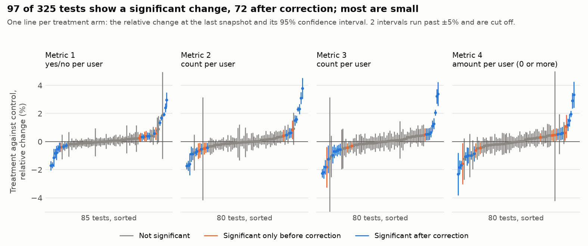
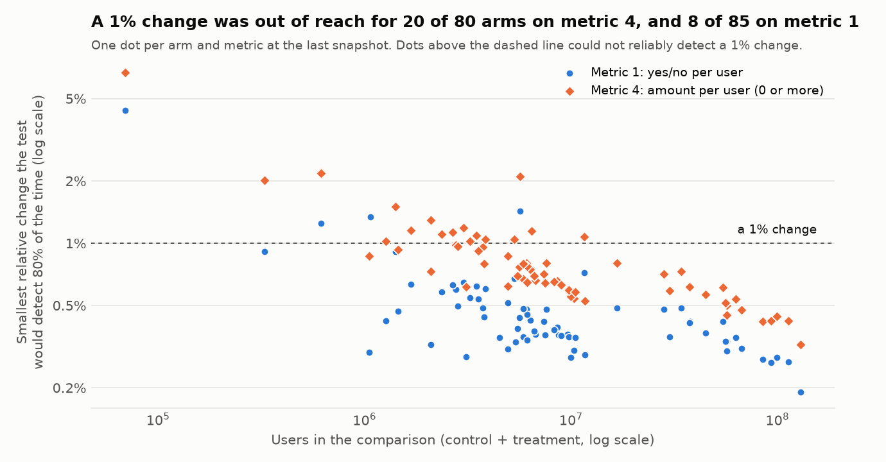
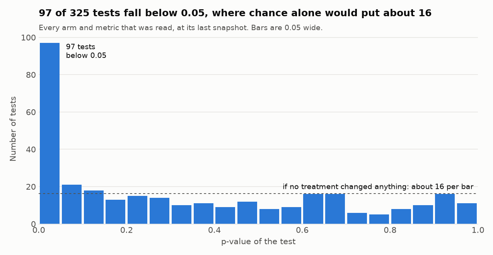

# Part 2: the readout

*Generated by `scripts/readout_report.py` from the committed source file. Every number below is computed by the script; nothing is typed in by hand.*

Part 1 decided which experiments can be read. This part reads them: for each treatment arm and each of the four metrics, how big the change is, how sure the data is about it, whether the test was big enough to see a change worth having, and what reading four metrics at once does to the chance of a false alarm. Everything uses each arm's last snapshot.

**Headline:** of 325 tests read in 85 arms, 97 are significant at the usual 5% level, where chance alone would give about 16. 72 are still significant once each experiment's tests are corrected for being read together. The changes are small: the median significant change is 0.76% of the control mean, and the largest is 3.8%.

**One thing this readout cannot say is which changes are good.** The source does not name the metrics, so a higher value may be a gain (more orders) or a loss (more returns). The report says "higher" and "lower", never "won" and "lost".

## 1. What is read

The dataset has 99 treatment arms and four metrics, so 396 arm × metric rows ([`sql/final_snapshot.sql`](../sql/final_snapshot.sql)). Part 1's cautions ([`arm_checks.csv`](arm_checks.csv)) decide how each is treated:

| Reading | When | Arm × metric rows |
| --- | --- | ---: |
| read | nothing in Part 1 stands in the way | 304 |
| read with warning | the arm has a sample-ratio mismatch or a drifting split; the result is shown and marked | 21 |
| not testable | the source has no variance for this metric at the last snapshot | 15 |
| not decided | the arm's split is far from even with no published design, or it ran under a week | 56 |

- **14 arms are not decided on:** 8 whose split is far from even and 6 that ran under a week. Their figures are in [`readout.csv`](readout.csv) for completeness and are left out of every count below.
- **85 arms in 73 experiments are read**, 6 of them with a warning. 5 of the arms read have no variance for metrics 2 to 4, so only their metric 1 can be tested. That leaves **325 tests**.

## 2. How each number is calculated

All from the group-level figures in the source (users, mean, variance per group), in [`abtest/readout.py`](../abtest/readout.py):

- **Relative change** = treatment mean ÷ control mean − 1. A relative figure lets tests with different baselines be compared.
- **95% confidence interval** for the relative change, by the delta method (the standard way to put an interval on a ratio of two means).
- **p-value** from Welch's t-test on the difference in means, which does not assume the two groups have equal variance or equal size. With this many users the test and the interval agree: they disagree on whether a change is significant in 0 of 325 tests.
- **Smallest detectable change** = 2.80 × the standard error of the difference ÷ the control mean: the true change this test would have flagged 80% of the time at the 5% level.
- **Correction for multiple tests:** Holm's method over all the tests of one experiment (every arm and metric read together to make one decision). Section 5 explains why.

## 3. What the tests found

| Metric | Tests read | Significant (p < 0.05) | Treatment higher | Treatment lower | Median size of a significant change | Significant after correction |
| --- | ---: | ---: | ---: | ---: | ---: | ---: |
| 1: yes/no per user | 85 | 25 | 15 | 10 | 0.53% | 19 |
| 2: count per user | 80 | 24 | 11 | 13 | 0.80% | 18 |
| 3: count per user | 80 | 23 | 10 | 13 | 0.69% | 19 |
| 4: amount per user (0 or more) | 80 | 25 | 14 | 11 | 0.99% | 16 |

- **97 of 325 tests (30%) are significant at p < 0.05.** If no treatment changed anything, about 16 would be. So many of these changes are real, and a meaningful share may still be false alarms: section 5.
- **The changes are small.** Among the significant ones the size runs from 0.27% to 3.78% of the control mean, with a median of 0.76%; 58 of the 97 are under 1%. The largest is arm `ee6ff7` / 1, metric 2, at +3.78%.
- **Direction is split almost evenly:** treatment is higher in 50 of the significant tests and lower in 47. Without metric names that is all that can be said.
- **Within an arm the metrics agree.** 0 arms have one metric significantly higher and another significantly lower. The four metrics move together: across arms, the test statistics of any two metrics have a rank correlation of at least 0.75. That matters for section 5.

The ten largest changes that are still significant after correction:

| Arm | Metric | Users | Relative change | 95% interval | p | p after correction | Reading |
| --- | ---: | ---: | ---: | ---: | ---: | ---: | --- |
| `ee6ff7` / 1 | 2 | 2,097,447 | +3.78% | +3.05% to +4.52% | < 1e-15 | < 1e-15 | read |
| `ee6ff7` / 1 | 3 | 2,097,447 | +3.39% | +2.54% to +4.25% | 2.5e-15 | 5.1e-15 | read |
| `ee6ff7` / 1 | 4 | 2,097,447 | +3.34% | +2.42% to +4.27% | 5.1e-13 | 5.1e-13 | read |
| `b3280a` / 1 | 3 | 6,152,839 | +3.22% | +2.70% to +3.74% | < 1e-15 | < 1e-15 | read |
| `b3280a` / 1 | 2 | 6,152,839 | +3.09% | +2.66% to +3.52% | < 1e-15 | < 1e-15 | read |
| `ee6ff7` / 1 | 1 | 2,097,447 | +2.97% | +2.46% to +3.48% | < 1e-15 | < 1e-15 | read |
| `b3280a` / 1 | 4 | 6,152,839 | +2.91% | +2.36% to +3.46% | < 1e-15 | < 1e-15 | read |
| `b3280a` / 1 | 1 | 6,152,839 | +2.41% | +2.09% to +2.73% | < 1e-15 | < 1e-15 | read |
| `79f97f` / 1 | 2 | 3,108,256 | +2.32% | +1.96% to +2.67% | < 1e-15 | < 1e-15 | read |
| `b382c6` / 2 | 4 | 613,577 | -2.31% | -3.81% to -0.80% | 0.003 | 0.024 | read |

## 4. Was each test big enough?

A test that finds nothing has two possible meanings: there is nothing to find, or the test was too small to see it. The smallest detectable change tells them apart.

Smallest relative change each test would detect 80% of the time, and the users an even two-group test would need for a metric with the median spread:

| Metric | Smallest | Median | Largest | Could detect a 1% change | Median SD ÷ mean | Users per group for 1% | Users per group for 0.5% |
| --- | ---: | ---: | ---: | ---: | ---: | ---: | ---: |
| 1: yes/no per user | 0.19% | 0.42% | 4.37% | 77 of 85 | 2.02 | 639,062 | 2,556,247 |
| 2: count per user | 0.24% | 0.56% | 5.24% | 72 of 80 | 2.75 | 1,191,379 | 4,765,514 |
| 3: count per user | 0.31% | 0.68% | 6.25% | 64 of 80 | 3.23 | 1,635,147 | 6,540,587 |
| 4: amount per user (0 or more) | 0.32% | 0.72% | 6.70% | 60 of 80 | 3.43 | 1,847,154 | 7,388,613 |

- **Most of these tests are very sensitive.** 273 of the 325 tests could detect a 1% change, and the best could detect 0.19%. The least sensitive could only detect 6.7%.
- **The noisier the metric, the more users it takes.** Detecting a 1% change needs about 639,000 users per group for metric 1 and about 1,847,000 for metric 4, 2.9 times as many. Halving the change to detect quadruples the users needed.
- **What "not significant" means here.** 228 tests are not significant. In 189 of them the whole confidence interval lies between −1% and +1%: those tests rule out a change of 1% or more in either direction, which is a finding. In the other 39 the interval reaches past 1%, so the test is inconclusive and "no effect" would be the wrong reading.

The 1% reference is a working choice. A real team would set it from what the change costs to build and run, before the test starts.

## 5. Four metrics at once

Each test has a 5% chance of a false alarm when nothing changed. Reading four metrics gives four chances: up to 18.5% for at least one false alarm in an arm if the metrics were independent. An experiment with several arms has more: the largest family here has 8 tests, and up to 34%. The metrics here move together (section 3), so the true figures are lower, but they are well above 5%.

How many metrics are significant in each of the 85 arms read:

| Significant metrics in the arm | Arms |
| --- | ---: |
| 0 | 44 |
| 1 | 13 |
| 2 | 11 |
| 3 | 6 |
| 4 | 11 |

- **41 of 85 arms (48%) have at least one significant metric.** A team that calls a test a result whenever any metric moves would report a change for almost half of everything it runs.
- **After Holm's correction within each experiment, 29 arms still have one**, and 72 of the 97 significant tests survive. The other 25 are the ones to treat as unconfirmed: each could be real, but not on this evidence.
- **A second view gives a similar answer.** The Benjamini-Hochberg method, applied across all 325 tests to keep false alarms to about 5% of the results called significant, keeps 66 tests in 29 arms.
- **11 arms are significant on every metric they report.** Those are the clear results.

## 6. Arms read with a warning

6 arms have a sample-ratio mismatch or a drifting split (Part 1). Their 21 tests are included above; 4 are significant, and 0 after correction.

| Arm | Part 1 cautions | Tests | Significant (p < 0.05) | After correction |
| --- | --- | ---: | ---: | ---: |
| `26bd38` / 1 | sample-ratio mismatch; split drifts; gap in snapshots | 4 | 3 | 0 |
| `530a76` / 1 | sample-ratio mismatch | 4 | 1 | 0 |
| `834947` / 1 | sample-ratio mismatch | 4 | 0 | 0 |
| `a68bf4` / 1 | sample-ratio mismatch | 4 | 0 | 0 |
| `c4df76` / 1 | split drifts | 4 | 0 | 0 |
| `cf1b96` / 1 | split drifts; first week not recorded; variance missing | 1 | 0 | 0 |

A significant result in one of these arms needs the cause of the caution found before anyone acts on it: if the users who went missing differ from those who stayed, the two groups are no longer comparable, and the test cannot show how large that bias is.

## 7. So what, for a team that runs experiments

1. **Expect small changes and size tests for them.** The median significant change here is 0.76%. The largest is 3.8%, so a test sized to detect only a 5% change is sized for something that did not happen here. Detecting 1% takes roughly 0.6 to 1.8 million users per group, depending on the metric.
2. **Pick the deciding metric before the test.** With four metrics, 41 of 85 arms show "something"; after correction 29 do. One primary metric named in advance needs no correction, and the others become guard rails (Part 4).
3. **Report the interval, not just "significant" or "not".** 189 of the 228 quiet results are tight enough to say the change is under 1% either way, which can settle a decision. The other 39 say only that the test was too small.
4. **Record what each metric is and which direction is good.** This dataset shows what is left without that: 50 changes up and 47 down, and no way to call any of them a win.

## 8. Limits

- Each arm is read once, at its last snapshot. If a team stopped a test because of what the results showed, the p-values here are too small. Part 3 measures that.
- The 5% level, 80% power and the 1% reference change are conventions and working choices, set in `abtest/readout.py`.
- Users are treated as independent and the metrics as close to normal on average. The smallest group read has 34,497 users, so the second is safe even for skewed metrics; the first cannot be checked without user-level data.
- Arms of one experiment share a control group, so their results are not independent. Holm's correction is valid under any dependence; the "by chance" figures in section 5 assume independence and are upper ends.
- A significant change found by a test that could barely detect it tends to be overstated. The sizes in section 3 are best read as upper estimates for the less sensitive tests.
- Not being named, the metrics cannot be given a direction, a money value or a guard-rail role. Part 4 sets out decision rules that would apply once they are.
